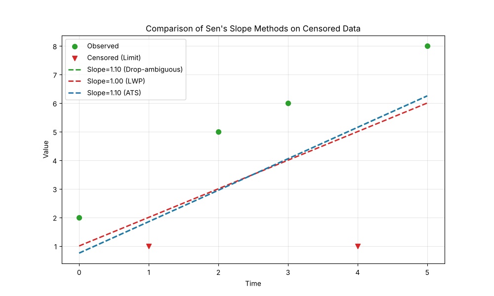

# Example 20: Advanced Sen's Slope Methods

## The "Why": Handling Ambiguity in Censored Trends

When you have censored data (e.g., `<1`), calculating a simple slope becomes tricky.
*   Slope between `5` and `10`: Easy (5).
*   Slope between `<1` and `10`: Ambiguous. Is `<1` actually `0.9`? `0.0`? `0.5`?
    *   If it's `0.9`, slope is `(10 - 0.9)`.
    *   If it's `0.0`, slope is `(10 - 0.0)`.

Standard methods often just substitute a value (like 0.5), but this can be biased.

The package offers three methods for calculating the slope (`sens_slope_method`):
1.  **`'ats'` (Akritas-Theil-Sen, Default)**: The slope at which Kendall's S between time and the residuals is zero, treating censored values as intervals (as `NADA::cenken`). No values are substituted.
2.  **`'unbiased'` / `'nan'`**: Pairwise slopes with substituted censored values; ambiguous pairs (e.g. Left-Censored vs. Left-Censored) are dropped (set to NaN). Despite its name this pushes the slope *away* from zero, because the dropped pairs mostly oppose the trend.
3.  **`'lwp'` (LWP-TRENDS)**: Ambiguous slopes are forced to **0**. This "dilutes" the trend, making the slope smaller (closer to zero). This mimics the specific behavior of the LWP-TRENDS R script.

## The "How": Comparison

### Step 1: Python Code
```python
import numpy as np
import pandas as pd
import MannKS as mk
import os

# 1. Generate Synthetic Data
# We create a dataset with censored values that create ambiguous slopes.
# Ambiguous: Slope between a censored value and a real value where direction is uncertain.
# Actually, LWP defines ambiguous cases specifically.
# Let's use a small dataset to trace it easily.
x = [2, '<1', 5, 6, '<1', 8]
t = np.arange(len(x))

# Prepare data
df = mk.prepare_censored_data(x)
print("--- Data ---")
print(df[['value', 'censored', 'cen_type']])

# 2. Run Trend Tests with Different Methods

# Method A: Robust (Standard) - 'nan'
# Ambiguous slopes (e.g. <1 vs 10) are set to NaN and ignored.
res_robust = mk.trend_test(df, t, mk_test_method='robust', sens_slope_method='unbiased')

# Method B: LWP - 'lwp'
# Ambiguous slopes are set to 0.
# Also, right-censored handling is different (if we had any).
res_lwp = mk.trend_test(df, t, mk_test_method='lwp', sens_slope_method='lwp')

# Method C: ATS (Akritas-Theil-Sen) - 'ats'
# A completely different, robust estimator for censored data.
res_ats = mk.trend_test(df, t, sens_slope_method='ats')

print("\n--- 1. Robust (Nan) Method ---")
print(f"Trend: {res_robust.trend}")
print(f"Slope: {res_robust.slope:.4f}")

print("\n--- 2. LWP Method (Ambiguous=0) ---")
print(f"Trend: {res_lwp.trend}")
print(f"Slope: {res_lwp.slope:.4f}")

print("\n--- 3. ATS Method ---")
print(f"Trend: {res_ats.trend}")
print(f"Slope: {res_ats.slope:.4f}")

# 3. Visualization
import matplotlib.pyplot as plt
# Use absolute path to save in the same directory as the script
script_dir = os.path.dirname(os.path.abspath(__file__)) if '__file__' in globals() else '.'
plot_path = os.path.join(script_dir, 'slope_comparison.png')

plt.figure(figsize=(10, 6))

# Plot Data
# We plot censored values (limit) as triangles, observed as circles
vals = df['value']
censored = df['censored']
plt.scatter(t[~censored], vals[~censored], color='tab:green', label='Observed', s=50, zorder=5)
plt.scatter(t[censored], vals[censored], color='tab:red', marker='v', label='Censored (Limit)', s=50, zorder=5)

# Plot Trend Lines (pivoted at median time/value roughly for visualization)
# Note: Intercepts are not returned by all methods in a comparable way (ATS is complex),
# so we will anchor lines at the median of non-censored data for visual comparison.
t_med = np.median(t)
y_med = np.median(vals) # rough anchor

# Define a helper to plot line with slope m
def plot_slope(t_vals, m, color, label, tm, ym):
    # y = m * (x - t_med) + y_med
    y_vals = m * (t_vals - tm) + ym
    plt.plot(t_vals, y_vals, color=color, linestyle='--', label=f'Slope={m:.2f} ({label})', linewidth=2)

plot_slope(t, res_robust.slope, 'tab:green', 'Drop-ambiguous', t_med, y_med)
plot_slope(t, res_lwp.slope, 'tab:red', 'LWP', t_med, y_med)
plot_slope(t, res_ats.slope, 'tab:blue', 'ATS', t_med, y_med)

plt.title("Comparison of Sen's Slope Methods on Censored Data")
plt.xlabel("Time")
plt.ylabel("Value")
plt.legend()
plt.grid(True, alpha=0.3)
plt.savefig(plot_path)
print(f"\nPlot saved to 'slope_comparison.png'")
```

### Step 2: Text Output
```text
--- Data ---
   value  censored cen_type
0    2.0     False      not
1    1.0      True       lt
2    5.0     False      not
3    6.0     False      not
4    1.0      True       lt
5    8.0     False      not

--- 1. Robust (Nan) Method ---
Trend: increasing
Slope: 1.1000

--- 2. LWP Method (Ambiguous=0) ---
Trend: increasing
Slope: 1.0000

--- 3. ATS Method ---
Trend: increasing
Slope: 1.1000

Plot saved to 'slope_comparison.png'

```

## Interpreting the Results

### 1. The Numbers
*   **Drop-ambiguous (`'unbiased'`)**: Calculates the median of only the "sure" slopes. It tends to give the steepest trend because the pairs it ignores are mostly those that oppose the trend.
*   **LWP (`'lwp'`)**: Returns a smaller slope. Why? Because it took all those "I'm not sure" pairs and called them "0 slope". If you have many censored values, this method will strongly bias your trend magnitude towards zero.
*   **ATS (`'ats'`)**: The standard estimator for censored trends (Helsel 2012). It uses only the information the censored values actually carry (that they lie below their limit) instead of substituting a single number.

In this dataset the LWP method yields a lower slope because it treats the ambiguous pairs (between censored and non-censored values) as "zero slope", which drags the median down. In simulations with a known trend, ATS was the least biased of the three (within a few percent up to 50% censoring), while the drop-ambiguous method overestimated and the LWP method underestimated the slope as censoring increased.

### 2. Visualizing the Difference


*   **Green Line (Drop-ambiguous)**: Typically the steepest.
*   **Red Line (LWP)**: Flattest (biased towards 0).
*   **Blue Line (ATS)**: The robust statistical estimate.

## Recommendation
*   Use **`'ats'`** (default) for censored data.
*   Use **`'lwp'`** only if you need to match the LWP-TRENDS R script.
*   `'unbiased'` is kept for backward compatibility; it is not recommended.
