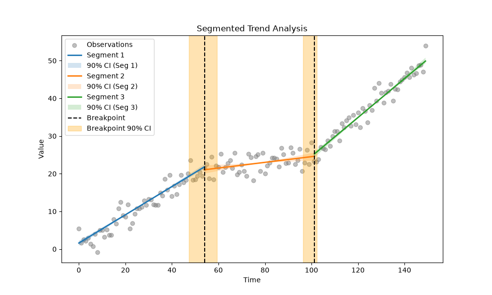
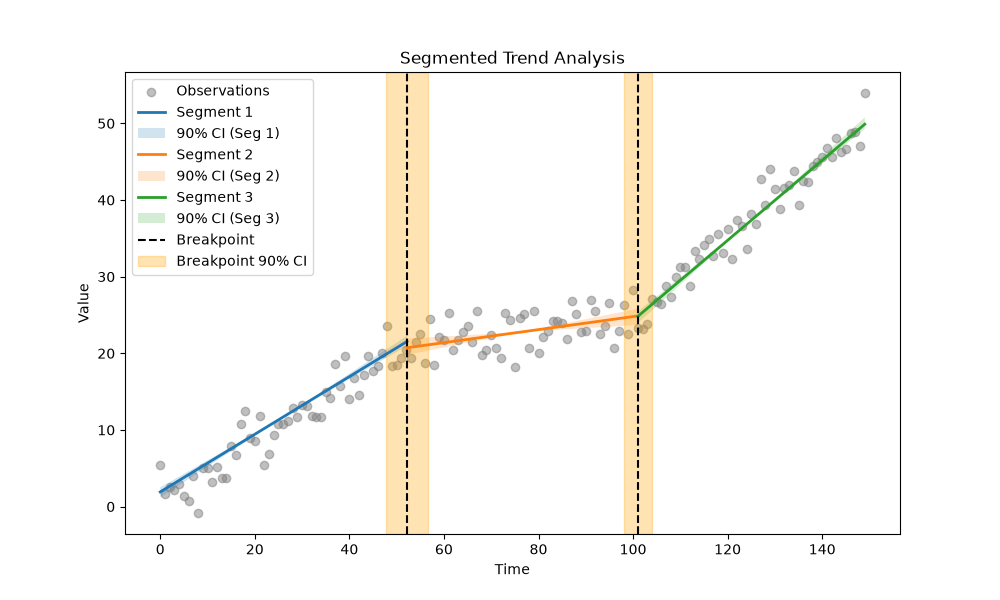
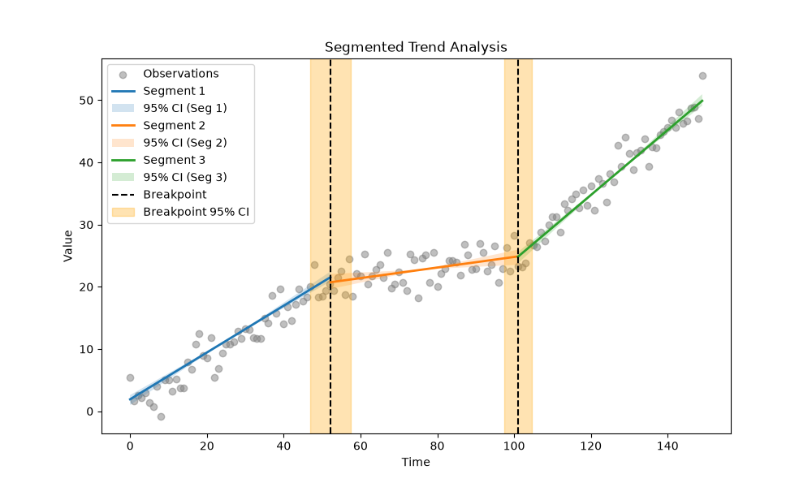
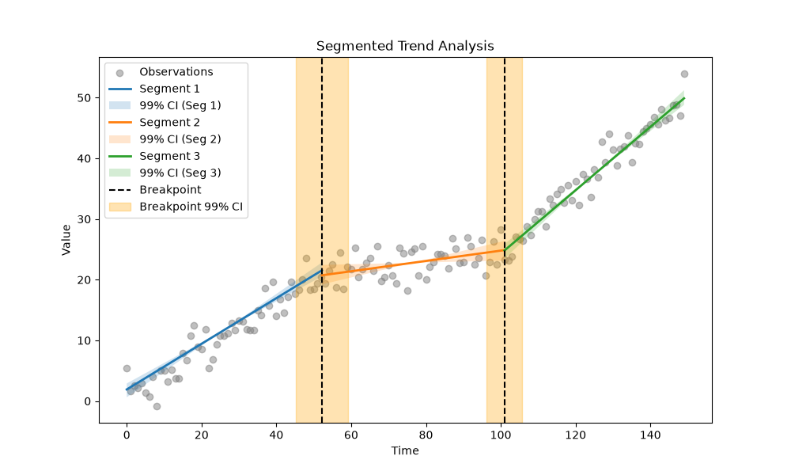

# Example 33: Varying Alpha and Method Comparison

## Overview
This example demonstrates how the `alpha` parameter impacts the Segmented Trend Analysis. The `alpha` value controls the significance level for the Confidence Intervals (CI).

*   **Alpha = 0.10**: 90% Confidence Interval (Narrower)
*   **Alpha = 0.05**: 95% Confidence Interval (Standard)
*   **Alpha = 0.01**: 99% Confidence Interval (Wider)

We also compare two methods for Breakpoint Detection:
1.  **Bagging (Bootstrap Aggregating):** Robust, creates non-parametric CIs for breakpoints.
2.  **Standard OLS:** Faster, assumes normally distributed errors for breakpoint CIs.

## The Data
We simulate a time series with **2 breakpoints** (3 segments) and moderate noise (std=2.0). The slopes are chosen to be relatively close (0.4, 0.1, 0.5) to make the exact breakpoint location uncertain.

## Part 1: Bagging Method

### Code
```python
import os
import numpy as np
import pandas as pd
from MannKS.segmented_trend_test import segmented_trend_test
from MannKS.plotting import plot_segmented_trend

def run_bagging():
    # -------------------------------------------------------------------------
    # 1. Generate Synthetic Data
    # -------------------------------------------------------------------------
    # We create a time series with 3 segments (2 breakpoints).
    # The slopes are relatively close (0.4, 0.1, 0.5) to make precise breakpoint
    # detection challenging, highlighting the utility of robust methods.
    np.random.seed(101)
    n = 150
    t = np.arange(n)

    # Define True Trend:
    # - Seg 1 (0-50):   Slope 0.4
    # - Seg 2 (50-100): Slope 0.1 (Flatter)
    # - Seg 3 (100-150): Slope 0.5 (Steeper)
    trend = np.concatenate([
        0.4 * t[:50],
        0.4 * 50 + 0.1 * (t[50:100] - 50),
        0.4 * 50 + 0.1 * 50 + 0.5 * (t[100:] - 100)
    ])

    # Add Moderate Noise (Gaussian)
    # With std=2.0, the signal-to-noise ratio is low enough to create
    # uncertainty about the exact breakpoint location.
    noise_std = 2.0
    x = trend + np.random.normal(0, noise_std, n)

    # -------------------------------------------------------------------------
    # 2. Run Analysis with Varying Alpha Levels
    # -------------------------------------------------------------------------
    # We test three significance levels:
    # - 0.10: 90% Confidence (Narrowest intervals)
    # - 0.05: 95% Confidence (Standard)
    # - 0.01: 99% Confidence (Widest intervals)
    alphas = [0.10, 0.05, 0.01]

    for alpha in alphas:
        confidence_pct = int((1-alpha)*100)
        print(f"\n{'='*60}")
        print(f"Bagging Analysis with Alpha = {alpha} ({confidence_pct}% Confidence)")
        print(f"{'='*60}")

        # Use Bagging (Bootstrap Aggregating)
        # -----------------------------------
        # Bagging improves robustness by resampling the data and re-fitting the
        # breakpoint model multiple times (n_bootstrap).
        # - The breakpoint location is estimated from the distribution of bootstrapped results.
        # - The Confidence Intervals (CIs) are non-parametric (percentile-based),
        #   often resulting in asymmetric intervals that better reflect reality.
        result = segmented_trend_test(
            x, t,
            n_breakpoints=2, # We fix the number of breakpoints for this example
            alpha=alpha,
            use_bagging=True,
            n_bootstrap=50, # Number of bootstrap iterations (higher is better for production)
            random_state=42 # Set seed for reproducibility
        )

        # Print Breakpoint details
        print("Breakpoint Results:")
        if result.n_breakpoints > 0:
            bp_df = pd.DataFrame({
                'Breakpoint': result.breakpoints,
                'Lower CI': [ci[0] for ci in result.breakpoint_cis],
                'Upper CI': [ci[1] for ci in result.breakpoint_cis]
            })
            print(bp_df.to_markdown(index=False, floatfmt=".2f"))
        else:
            print("No breakpoints found.")

        # Print Segment details
        # The slopes are calculated using the Sen's slope estimator on the
        # identified segments. Their CIs also respect the 'alpha' parameter.
        print("\nSegment Results:")
        cols = ['slope', 'lower_ci', 'upper_ci']
        print(result.segments[cols].to_markdown(index=False, floatfmt=".4f"))

        # Visualize
        # The plotting function automatically labels the CIs with the correct percentage.
        fname = f'segmented_plot_alpha_{alpha}_bagging.png'
        save_path = os.path.join(os.path.dirname(__file__), fname)
        plot_segmented_trend(result, x, t, save_path=save_path)
        print(f"Plot saved to {fname}")

if __name__ == "__main__":
    run_bagging()
```

### Output
```text
============================================================
Bagging Analysis with Alpha = 0.1 (90% Confidence)
============================================================
Breakpoint Results:
|   Breakpoint |   Lower CI |   Upper CI |
|-------------:|-----------:|-----------:|
|        54.03 |      47.29 |      59.48 |
|       101.25 |      96.42 |     102.41 |

Segment Results:
|   slope |   lower_ci |   upper_ci |
|--------:|-----------:|-----------:|
|  0.3746 |     0.3520 |     0.4001 |
|  0.0755 |     0.0273 |     0.1173 |
|  0.5161 |     0.4905 |     0.5541 |
Plot saved to segmented_plot_alpha_0.1_bagging.png

============================================================
Bagging Analysis with Alpha = 0.05 (95% Confidence)
============================================================
Breakpoint Results:
|   Breakpoint |   Lower CI |   Upper CI |
|-------------:|-----------:|-----------:|
|        54.03 |      47.20 |      60.21 |
|       101.25 |      96.28 |     102.44 |

Segment Results:
|   slope |   lower_ci |   upper_ci |
|--------:|-----------:|-----------:|
|  0.3746 |     0.3486 |     0.4043 |
|  0.0755 |     0.0207 |     0.1255 |
|  0.5161 |     0.4855 |     0.5610 |
Plot saved to segmented_plot_alpha_0.05_bagging.png

============================================================
Bagging Analysis with Alpha = 0.01 (99% Confidence)
============================================================
Breakpoint Results:
|   Breakpoint |   Lower CI |   Upper CI |
|-------------:|-----------:|-----------:|
|        54.03 |      46.98 |      60.50 |
|       101.25 |      95.69 |     102.46 |

Segment Results:
|   slope |   lower_ci |   upper_ci |
|--------:|-----------:|-----------:|
|  0.3746 |     0.3381 |     0.4180 |
|  0.0755 |     0.0027 |     0.1413 |
|  0.5161 |     0.4706 |     0.5751 |
Plot saved to segmented_plot_alpha_0.01_bagging.png
```

## Part 2: Standard OLS Method

### Code
```python
import os
import numpy as np
import pandas as pd
from MannKS.segmented_trend_test import segmented_trend_test
from MannKS.plotting import plot_segmented_trend

def run_ols():
    # -------------------------------------------------------------------------
    # 1. Generate Synthetic Data
    # -------------------------------------------------------------------------
    # We use the exact same seed and data generation parameters as the bagging
    # example to ensure a fair comparison.
    np.random.seed(101)
    n = 150
    t = np.arange(n)

    # Define True Trend:
    # - Seg 1 (0-50):   Slope 0.4
    # - Seg 2 (50-100): Slope 0.1 (Flatter)
    # - Seg 3 (100-150): Slope 0.5 (Steeper)
    trend = np.concatenate([
        0.4 * t[:50],
        0.4 * 50 + 0.1 * (t[50:100] - 50),
        0.4 * 50 + 0.1 * 50 + 0.5 * (t[100:] - 100)
    ])

    # Moderate Noise
    noise_std = 2.0
    x = trend + np.random.normal(0, noise_std, n)

    # -------------------------------------------------------------------------
    # 2. Run Analysis with Varying Alpha Levels
    # -------------------------------------------------------------------------
    alphas = [0.10, 0.05, 0.01]

    for alpha in alphas:
        confidence_pct = int((1-alpha)*100)
        print(f"\n{'='*60}")
        print(f"Standard OLS Analysis with Alpha = {alpha} ({confidence_pct}% Confidence)")
        print(f"{'='*60}")

        # Use Standard OLS (Ordinary Least Squares)
        # -----------------------------------------
        # This method uses the `piecewise-regression` library directly without bagging.
        # - It is much faster than bagging.
        # - It assumes normally distributed errors for calculating Confidence Intervals.
        # - Breakpoint CIs are often symmetric and may be narrower than reality
        #   in noisy or complex data (like this example).
        result = segmented_trend_test(
            x, t,
            n_breakpoints=2,
            alpha=alpha,
            use_bagging=False # Disable bagging for standard OLS
        )

        # Print Breakpoint details
        print("Breakpoint Results:")
        # We manually calculate these CIs based on the standard error and t-distribution
        # for the requested alpha (see `MannKS/_segmented.py`).
        if result.n_breakpoints > 0:
            bp_df = pd.DataFrame({
                'Breakpoint': result.breakpoints,
                'Lower CI': [ci[0] for ci in result.breakpoint_cis],
                'Upper CI': [ci[1] for ci in result.breakpoint_cis]
            })
            print(bp_df.to_markdown(index=False, floatfmt=".2f"))
        else:
            print("No breakpoints found.")

        # Print Segment details
        print("\nSegment Results:")
        cols = ['slope', 'lower_ci', 'upper_ci']
        print(result.segments[cols].to_markdown(index=False, floatfmt=".4f"))

        # Visualize
        fname = f'segmented_plot_alpha_{alpha}_ols.png'
        save_path = os.path.join(os.path.dirname(__file__), fname)
        plot_segmented_trend(result, x, t, save_path=save_path)
        print(f"Plot saved to {fname}")

if __name__ == "__main__":
    run_ols()
```

### Output
```text
============================================================
Standard OLS Analysis with Alpha = 0.1 (90% Confidence)
============================================================
Breakpoint Results:
|   Breakpoint |   Lower CI |   Upper CI |
|-------------:|-----------:|-----------:|
|        52.19 |      47.82 |      56.55 |
|       101.00 |      97.98 |     104.02 |

Segment Results:
|   slope |   lower_ci |   upper_ci |
|--------:|-----------:|-----------:|
|  0.3761 |     0.3537 |     0.4043 |
|  0.0850 |     0.0369 |     0.1235 |
|  0.5224 |     0.4964 |     0.5593 |
Plot saved to segmented_plot_alpha_0.1_ols.png

============================================================
Standard OLS Analysis with Alpha = 0.05 (95% Confidence)
============================================================
Breakpoint Results:
|   Breakpoint |   Lower CI |   Upper CI |
|-------------:|-----------:|-----------:|
|        52.19 |      46.97 |      57.40 |
|       101.00 |      97.40 |     104.60 |

Segment Results:
|   slope |   lower_ci |   upper_ci |
|--------:|-----------:|-----------:|
|  0.3761 |     0.3499 |     0.4110 |
|  0.0850 |     0.0302 |     0.1293 |
|  0.5224 |     0.4899 |     0.5667 |
Plot saved to segmented_plot_alpha_0.05_ols.png

============================================================
Standard OLS Analysis with Alpha = 0.01 (99% Confidence)
============================================================
Breakpoint Results:
|   Breakpoint |   Lower CI |   Upper CI |
|-------------:|-----------:|-----------:|
|        52.19 |      45.30 |      59.07 |
|       101.00 |      96.24 |     105.76 |

Segment Results:
|   slope |   lower_ci |   upper_ci |
|--------:|-----------:|-----------:|
|  0.3761 |     0.3382 |     0.4257 |
|  0.0850 |     0.0148 |     0.1470 |
|  0.5224 |     0.4771 |     0.5783 |
Plot saved to segmented_plot_alpha_0.01_ols.png
```

## Visual Comparison

#### Alpha = 0.10 (90% Confidence)

| **Bagging** | **Standard OLS** |
| :---: | :---: |
|  |  |

#### Alpha = 0.05 (95% Confidence)

| **Bagging** | **Standard OLS** |
| :---: | :---: |
|  |  |

#### Alpha = 0.01 (99% Confidence)

| **Bagging** | **Standard OLS** |
| :---: | :---: |
|  |  |

## Insights

1.  **Slope CIs:** As `alpha` decreases (from 0.10 to 0.01), the confidence intervals for the slopes (and the shaded regions in the plots) become wider. This represents the increased certainty required to capture the true value.
2.  **Breakpoint CIs:**
    *   **Standard OLS** usually provides symmetric, often narrower confidence intervals around the detected breakpoint. However, these assume well-behaved errors and can be overly optimistic or misleading in complex data.
    *   **Bagging** provides non-parametric intervals that may be wider and asymmetric. This reflects the true uncertainty and multimodality of the breakpoint location distribution, especially when noise is high or slope differences are subtle. In this example, the Bagging intervals often capture the uncertainty more realistically.
