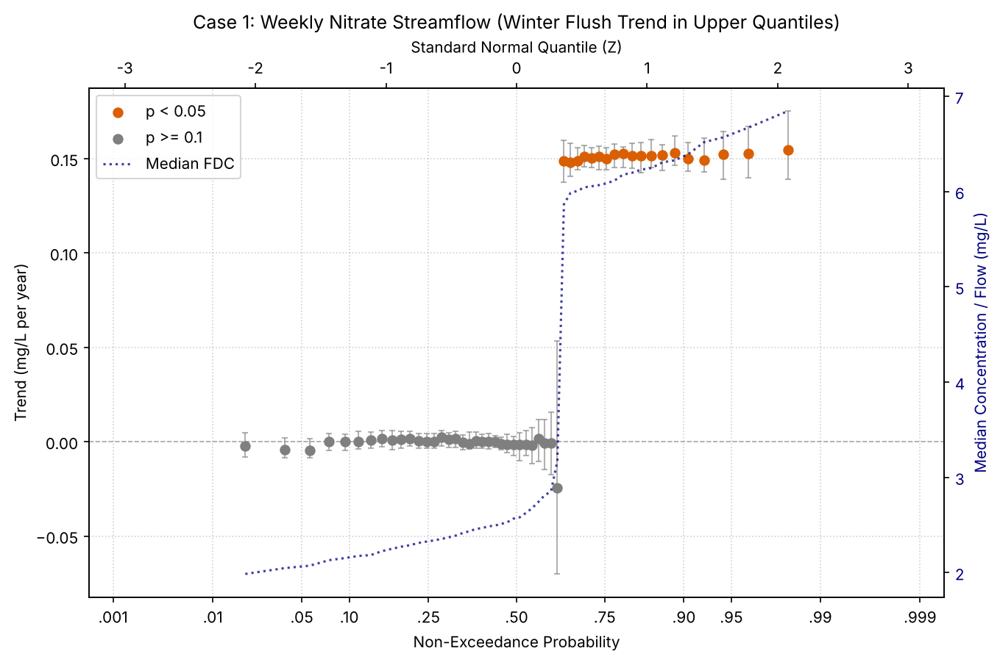
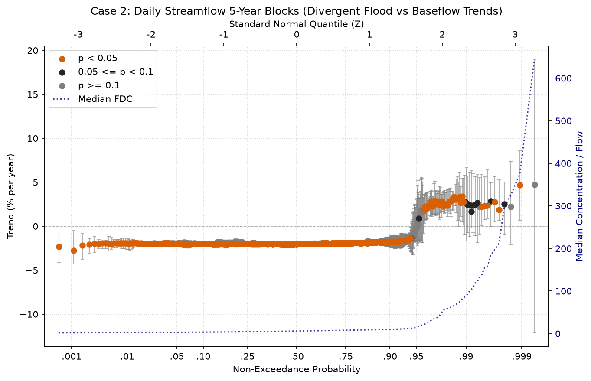
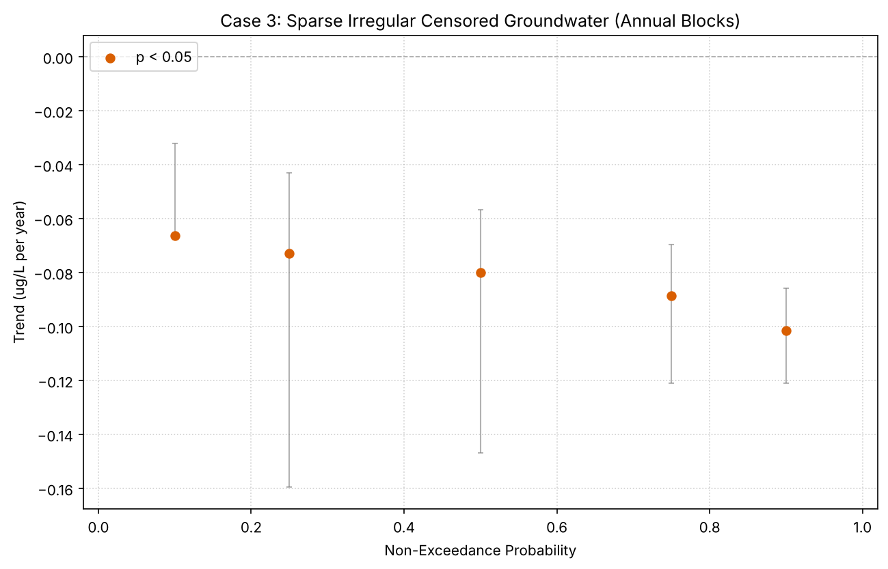
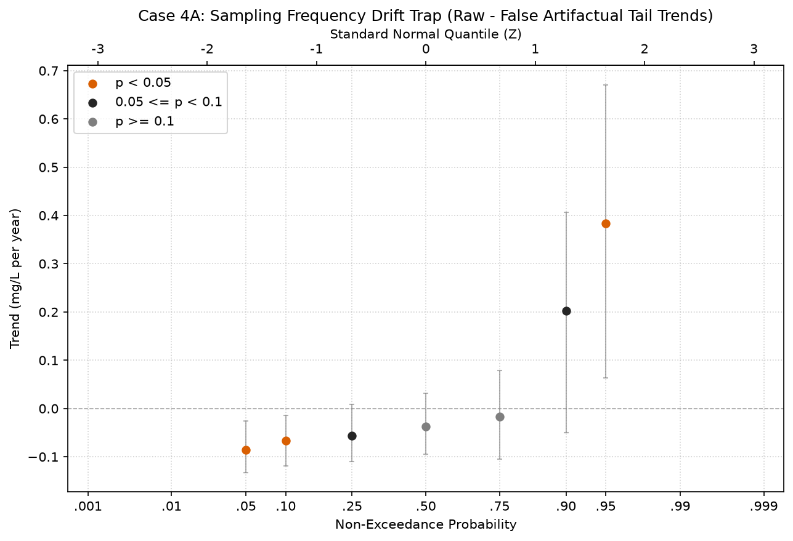
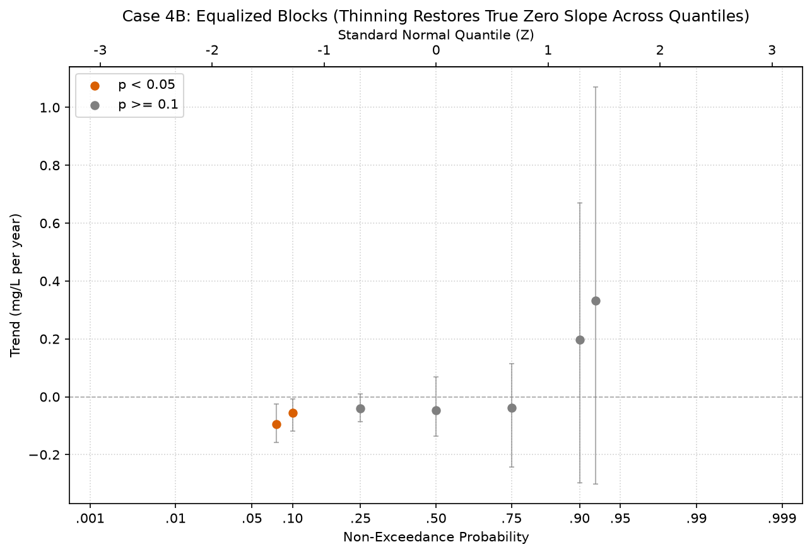

# Example 36: Generalized Quantile-Kendall Trend Analysis

This example demonstrates the **Generalized Quantile-Kendall (QK) Framework** introduced in **MannKS v0.7.0**. 

Traditional monotonic trend tests (such as standard Mann-Kendall or Seasonal Mann-Kendall) evaluate trends only in the **central tendency** (mean or median). However, environmental and hydrological changes rarely affect all percentiles uniformly:
- Agricultural pollution flushes streamflow concentrations primarily during high-runoff storm events (upper quantiles), leaving summer baseflow unchanged.
- Climate warming often intensifies hydrological extremes, causing flood peaks to increase while drought baseflows diminish.
- Ambient groundwater monitoring networks collect sparse, irregular, and censored data where classical daily methods cannot apply.
- Historical shifts in sampling frequency (e.g., transition from monthly to weekly monitoring) introduce severe sample-size artifacts into tail quantiles if not properly diagnosed and equalized.

MannKS v0.7.0 addresses these challenges by extending the order-statistic trend concept of USGS EGRET (*Hirsch et al., 2015*) into a **fully generalized, frequency-agnostic, censor-aware, and drift-protected** framework.

---

## Table of Contents
1. [Case 1: Weekly Nitrate Streamflow (Winter Flush Degradation)](#case-1-weekly-nitrate-streamflow)
2. [Case 2: Daily Streamflow with 5-Year Blocks (Divergent Hydrological Regimes)](#case-2-daily-streamflow-with-5-year-blocks)
3. [Case 3: Sparse Irregular Censored Groundwater (Ambient Monitoring)](#case-3-sparse-irregular-censored-groundwater)
4. [Case 4: The Sampling Frequency Drift Trap & Equalization](#case-4-the-sampling-frequency-drift-trap--equalization)
5. [Summary of Quantile-Kendall Diagnostics](#summary-of-quantile-kendall-diagnostics)

---

## Case 1: Weekly Nitrate Streamflow

### Scientific Background
A 20-year weekly streamflow monitoring program (2005–2024, $N=1,044$) tracks dissolved nitrate concentrations ($mg/L$) in an agricultural catchment. Subsurface tile drainage delivers heavy nitrate pulses during winter runoff events, while summer baseflow remains dominated by deep groundwater with stable concentrations.

A global median test would dilute this critical seasonal pollution signal. The Quantile-Kendall test segments the series into annual blocks (`block_frequency='YE'`), standardizes each year into 52 weekly order statistics, and evaluates Sen's slope across all non-exceedance probabilities.

### Python Code
```python
import numpy as np
import pandas as pd
from MannKS import quantile_trend_test, plot_quantile_trend, summarize_quantile_regimes

# 1. Generate 20 years of weekly monitoring data
rng = np.random.default_rng(42)
dates = pd.date_range("2005-01-01", "2024-12-31", freq="W")
years = (dates - dates[0]).days / 365.25
day_of_year = dates.day_of_year if hasattr(dates, 'day_of_year') else dates.dayofyear
is_winter = np.cos(2 * np.pi * (day_of_year - 30) / 365.25) > 0.4
nitrate = 1.2 + np.where(is_winter, 2.5 * (1.0 + 0.06 * years), 0.2) + rng.lognormal(0.0, 0.25, size=len(dates))

# 2. Run Generalized Quantile-Kendall Test
result = quantile_trend_test(
    x=nitrate,
    t=dates,
    block_frequency='YE',
    quantiles='auto',
    slope_scaling='year',
    x_unit='mg/L',
)

# 3. Diagnostic Plot with Flow Duration Curve overlay
plot_quantile_trend(
    result,
    save_path='case1_weekly_nitrate_qk.png',
    show_ci=True,
    show_fdc=True,
    title='Case 1: Weekly Nitrate Streamflow (Winter Flush Trend)',
)
```

### Visual Diagnostics


### Results & Regime Summary
The resulting quantile slopes show clear selective degradation in the upper percentiles:

#### Sample Results Across Ranks
| rank | quantile | plotting_position | slope   | p         | classification              |
| ---- | -------- | ----------------- | ------- | --------- | --------------------------- |
| 1    | 0.0096   | 0.0189            | -0.0022 | 0.4957    | Likely Decreasing           |
| 6    | 0.1058   | 0.1132            | 0.0001  | 0.8711    | As Likely as Not Increasing |
| 11   | 0.2019   | 0.2075            | 0.0018  | 0.5376    | Likely Increasing           |
| 16   | 0.2981   | 0.3019            | 0.0014  | 0.6265    | Likely Increasing           |
| 21   | 0.3942   | 0.3962            | 0.0001  | 0.9225    | As Likely as Not Increasing |
| 26   | 0.4904   | 0.4906            | -0.0014 | 0.7212    | As Likely as Not Decreasing |
| 31   | 0.5865   | 0.5849            | -0.0007 | 0.9225    | As Likely as Not Decreasing |
| 36   | 0.6827   | 0.6792            | 0.1488  | 1.303e-09 | Highly Likely Increasing    |
| 41   | 0.7788   | 0.7736            | 0.1523  | 1.303e-09 | Highly Likely Increasing    |
| 46   | 0.8750   | 0.8679            | 0.1518  | 1.947e-09 | Highly Likely Increasing    |
| 51   | 0.9712   | 0.9623            | 0.1525  | 1.365e-08 | Highly Likely Increasing    |

#### Quantile Regimes Breakdown
| regime | p_min  | p_max  | n_quantiles | median_slope | median_slope_pct | prop_significant | modal_classification        |
| ------ | ------ | ------ | ----------- | ------------ | ---------------- | ---------------- | --------------------------- |
| low    | 0.0000 | 0.2500 | 13          | 0.0002       | 0.0077           | 0.0000           | As Likely as Not Increasing |
| mid    | 0.2500 | 0.7500 | 26          | 9.308e-05    | 0.0038           | 0.2308           | As Likely as Not Decreasing |
| high   | 0.7500 | 1.0000 | 13          | 0.1518       | 2.4214           | 1.0000           | Highly Likely Increasing    |

**Key Takeaway:** The low and mid percentiles (summer baseflow) exhibit no significant trend ($p > 0.10$, slope $\approx 0$), whereas high quantiles ($p > 0.75$) exhibit highly significant increasing trends ($p < 0.001$, slope $> 0.15$ mg/L/year), capturing selective agricultural winter runoff pollution.

---

## Case 2: Daily Streamflow with 5-Year Blocks

### Scientific Background
30 years of daily streamflow ($m^3/s$) from 1990 to 2019 (~10,957 observations) are analyzed. In this watershed, climate change and land-use alterations have created **divergent hydrological regimes**:
1. Extreme precipitation events have intensified flood peaks (+3% per year in top quantiles).
2. Extended summer droughts and agricultural water extraction have caused baseflow to diminish (-2% per year in lower quantiles).

By setting `block_frequency='5YE'`, daily observations are grouped into 6 multi-year hydrological epochs of 1,826 order statistics each. Log-transformation (`transform='log'`) reports slopes directly as percentage change per year (`% per year`).

### Python Code
```python
# Daily streamflow with multi-year blocking and log transform
result2 = quantile_trend_test(
    x=daily_flow,
    t=daily_dates,
    block_frequency='5YE',
    quantiles='auto',
    transform='log',
    slope_scaling='year',
    x_unit='m3/s',
)

plot_quantile_trend(
    result2,
    save_path='case2_daily_flow_5y_qk.png',
    show_ci=True,
    show_fdc=True,
    title='Case 2: Daily Streamflow 5-Year Blocks (Divergent Flood vs Baseflow Trends)',
)

# Summarize custom hydrologic regimes
regimes2 = summarize_quantile_regimes(
    result2,
    regimes={
        'drought_baseflow': (0.0, 0.50),
        'moderate_flow': (0.50, 0.95),
        'flood_peaks': (0.95, 1.0),
    },
)
```

### Visual Diagnostics


### Results & Regime Summary
#### Sample Results Across Quantiles (%/year)
| rank | quantile | plotting_position | slope_pct | p      | classification              |
| ---- | -------- | ----------------- | --------- | ------ | --------------------------- |
| 1    | 0.0003   | 0.0005            | -2.3173   | 0.0242 | Highly Likely Decreasing    |
| 11   | 0.0058   | 0.0060            | -1.9099   | 0.0085 | Highly Likely Decreasing    |
| 21   | 0.0112   | 0.0115            | -1.9465   | 0.0085 | Highly Likely Decreasing    |
| 31   | 0.0167   | 0.0170            | -1.9832   | 0.0085 | Highly Likely Decreasing    |
| 41   | 0.0222   | 0.0224            | -1.9681   | 0.0085 | Highly Likely Decreasing    |
| 51   | 0.0277   | 0.0279            | -1.9583   | 0.0085 | Highly Likely Decreasing    |
| 61   | 0.0331   | 0.0334            | -1.9432   | 0.0085 | Highly Likely Decreasing    |
| 71   | 0.0386   | 0.0389            | -1.9468   | 0.0085 | Highly Likely Decreasing    |
| 81   | 0.0441   | 0.0443            | -1.9816   | 0.0085 | Highly Likely Decreasing    |
| 91   | 0.0496   | 0.0498            | -1.9612   | 0.0085 | Highly Likely Decreasing    |
| 101  | 0.0550   | 0.0553            | -1.9957   | 0.0085 | Highly Likely Decreasing    |
| 111  | 0.0605   | 0.0608            | -2.0049   | 0.0085 | Highly Likely Decreasing    |
| 121  | 0.0660   | 0.0662            | -2.0255   | 0.0085 | Highly Likely Decreasing    |
| 131  | 0.0715   | 0.0717            | -2.0091   | 0.0085 | Highly Likely Decreasing    |
| 141  | 0.0769   | 0.0772            | -1.9893   | 0.0085 | Highly Likely Decreasing    |
| 151  | 0.0824   | 0.0826            | -1.9875   | 0.0085 | Highly Likely Decreasing    |
| 161  | 0.0879   | 0.0881            | -2.0073   | 0.0085 | Highly Likely Decreasing    |
| 171  | 0.0934   | 0.0936            | -1.9876   | 0.0085 | Highly Likely Decreasing    |
| 181  | 0.0988   | 0.0991            | -1.9756   | 0.0085 | Highly Likely Decreasing    |
| 191  | 0.1043   | 0.1045            | -1.9839   | 0.0085 | Highly Likely Decreasing    |
| 201  | 0.1098   | 0.1100            | -1.9661   | 0.0085 | Highly Likely Decreasing    |
| 211  | 0.1153   | 0.1155            | -1.9932   | 0.0085 | Highly Likely Decreasing    |
| 221  | 0.1208   | 0.1210            | -1.9887   | 0.0085 | Highly Likely Decreasing    |
| 231  | 0.1262   | 0.1264            | -2.0115   | 0.0085 | Highly Likely Decreasing    |
| 241  | 0.1317   | 0.1319            | -2.0149   | 0.0085 | Highly Likely Decreasing    |
| 251  | 0.1372   | 0.1374            | -2.0231   | 0.0085 | Highly Likely Decreasing    |
| 261  | 0.1427   | 0.1429            | -2.0447   | 0.0085 | Highly Likely Decreasing    |
| 271  | 0.1481   | 0.1483            | -2.0385   | 0.0085 | Highly Likely Decreasing    |
| 281  | 0.1536   | 0.1538            | -2.0240   | 0.0085 | Highly Likely Decreasing    |
| 291  | 0.1591   | 0.1593            | -2.0238   | 0.0085 | Highly Likely Decreasing    |
| 301  | 0.1646   | 0.1648            | -2.0098   | 0.0085 | Highly Likely Decreasing    |
| 311  | 0.1700   | 0.1702            | -2.0028   | 0.0085 | Highly Likely Decreasing    |
| 321  | 0.1755   | 0.1757            | -2.0013   | 0.0085 | Highly Likely Decreasing    |
| 331  | 0.1810   | 0.1812            | -2.0082   | 0.0085 | Highly Likely Decreasing    |
| 341  | 0.1865   | 0.1866            | -2.0017   | 0.0085 | Highly Likely Decreasing    |
| 351  | 0.1919   | 0.1921            | -2.0141   | 0.0085 | Highly Likely Decreasing    |
| 361  | 0.1974   | 0.1976            | -2.0059   | 0.0085 | Highly Likely Decreasing    |
| 371  | 0.2029   | 0.2031            | -1.9863   | 0.0085 | Highly Likely Decreasing    |
| 381  | 0.2084   | 0.2085            | -1.9683   | 0.0085 | Highly Likely Decreasing    |
| 391  | 0.2139   | 0.2140            | -1.9980   | 0.0085 | Highly Likely Decreasing    |
| 401  | 0.2193   | 0.2195            | -1.9863   | 0.0085 | Highly Likely Decreasing    |
| 411  | 0.2248   | 0.2250            | -2.0025   | 0.0085 | Highly Likely Decreasing    |
| 421  | 0.2303   | 0.2304            | -1.9842   | 0.0085 | Highly Likely Decreasing    |
| 431  | 0.2358   | 0.2359            | -1.9853   | 0.0085 | Highly Likely Decreasing    |
| 441  | 0.2412   | 0.2414            | -1.9905   | 0.0085 | Highly Likely Decreasing    |
| 451  | 0.2467   | 0.2469            | -1.9843   | 0.0085 | Highly Likely Decreasing    |
| 461  | 0.2522   | 0.2523            | -1.9955   | 0.0085 | Highly Likely Decreasing    |
| 471  | 0.2577   | 0.2578            | -1.9855   | 0.0085 | Highly Likely Decreasing    |
| 481  | 0.2631   | 0.2633            | -1.9694   | 0.0085 | Highly Likely Decreasing    |
| 491  | 0.2686   | 0.2687            | -1.9575   | 0.0085 | Highly Likely Decreasing    |
| 501  | 0.2741   | 0.2742            | -1.9880   | 0.0085 | Highly Likely Decreasing    |
| 511  | 0.2796   | 0.2797            | -2.0087   | 0.0085 | Highly Likely Decreasing    |
| 521  | 0.2850   | 0.2852            | -2.0094   | 0.0085 | Highly Likely Decreasing    |
| 531  | 0.2905   | 0.2906            | -1.9694   | 0.0085 | Highly Likely Decreasing    |
| 541  | 0.2960   | 0.2961            | -1.9838   | 0.0085 | Highly Likely Decreasing    |
| 551  | 0.3015   | 0.3016            | -1.9993   | 0.0085 | Highly Likely Decreasing    |
| 561  | 0.3070   | 0.3071            | -1.9982   | 0.0085 | Highly Likely Decreasing    |
| 571  | 0.3124   | 0.3125            | -1.9905   | 0.0085 | Highly Likely Decreasing    |
| 581  | 0.3179   | 0.3180            | -1.9957   | 0.0085 | Highly Likely Decreasing    |
| 591  | 0.3234   | 0.3235            | -2.0123   | 0.0085 | Highly Likely Decreasing    |
| 601  | 0.3289   | 0.3290            | -1.9971   | 0.0085 | Highly Likely Decreasing    |
| 611  | 0.3343   | 0.3344            | -1.9901   | 0.0085 | Highly Likely Decreasing    |
| 621  | 0.3398   | 0.3399            | -2.0401   | 0.0085 | Highly Likely Decreasing    |
| 631  | 0.3453   | 0.3454            | -2.0308   | 0.0085 | Highly Likely Decreasing    |
| 641  | 0.3508   | 0.3508            | -2.0028   | 0.0085 | Highly Likely Decreasing    |
| 651  | 0.3562   | 0.3563            | -2.0155   | 0.0085 | Highly Likely Decreasing    |
| 661  | 0.3617   | 0.3618            | -2.0081   | 0.0085 | Highly Likely Decreasing    |
| 671  | 0.3672   | 0.3673            | -2.0383   | 0.0085 | Highly Likely Decreasing    |
| 681  | 0.3727   | 0.3727            | -2.0470   | 0.0085 | Highly Likely Decreasing    |
| 691  | 0.3781   | 0.3782            | -2.0319   | 0.0085 | Highly Likely Decreasing    |
| 701  | 0.3836   | 0.3837            | -2.0180   | 0.0085 | Highly Likely Decreasing    |
| 711  | 0.3891   | 0.3892            | -2.0230   | 0.0085 | Highly Likely Decreasing    |
| 721  | 0.3946   | 0.3946            | -2.0239   | 0.0085 | Highly Likely Decreasing    |
| 731  | 0.4001   | 0.4001            | -2.0239   | 0.0085 | Highly Likely Decreasing    |
| 741  | 0.4055   | 0.4056            | -2.0373   | 0.0085 | Highly Likely Decreasing    |
| 751  | 0.4110   | 0.4111            | -2.0561   | 0.0085 | Highly Likely Decreasing    |
| 761  | 0.4165   | 0.4165            | -2.0628   | 0.0085 | Highly Likely Decreasing    |
| 771  | 0.4220   | 0.4220            | -2.0636   | 0.0085 | Highly Likely Decreasing    |
| 781  | 0.4274   | 0.4275            | -2.0689   | 0.0085 | Highly Likely Decreasing    |
| 791  | 0.4329   | 0.4330            | -2.0735   | 0.0085 | Highly Likely Decreasing    |
| 801  | 0.4384   | 0.4384            | -2.0777   | 0.0085 | Highly Likely Decreasing    |
| 811  | 0.4439   | 0.4439            | -2.0694   | 0.0085 | Highly Likely Decreasing    |
| 821  | 0.4493   | 0.4494            | -2.0794   | 0.0085 | Highly Likely Decreasing    |
| 831  | 0.4548   | 0.4548            | -2.1041   | 0.0085 | Highly Likely Decreasing    |
| 841  | 0.4603   | 0.4603            | -2.0955   | 0.0085 | Highly Likely Decreasing    |
| 851  | 0.4658   | 0.4658            | -2.0666   | 0.0085 | Highly Likely Decreasing    |
| 861  | 0.4712   | 0.4713            | -2.0514   | 0.0085 | Highly Likely Decreasing    |
| 871  | 0.4767   | 0.4767            | -2.0564   | 0.0085 | Highly Likely Decreasing    |
| 881  | 0.4822   | 0.4822            | -2.0532   | 0.0085 | Highly Likely Decreasing    |
| 891  | 0.4877   | 0.4877            | -2.0435   | 0.0085 | Highly Likely Decreasing    |
| 901  | 0.4932   | 0.4932            | -2.0391   | 0.0085 | Highly Likely Decreasing    |
| 911  | 0.4986   | 0.4986            | -2.0571   | 0.0085 | Highly Likely Decreasing    |
| 921  | 0.5041   | 0.5041            | -2.0324   | 0.0085 | Highly Likely Decreasing    |
| 931  | 0.5096   | 0.5096            | -2.0421   | 0.0085 | Highly Likely Decreasing    |
| 941  | 0.5151   | 0.5151            | -2.0342   | 0.0085 | Highly Likely Decreasing    |
| 951  | 0.5205   | 0.5205            | -2.0307   | 0.0085 | Highly Likely Decreasing    |
| 961  | 0.5260   | 0.5260            | -2.0227   | 0.0085 | Highly Likely Decreasing    |
| 971  | 0.5315   | 0.5315            | -2.0067   | 0.0085 | Highly Likely Decreasing    |
| 981  | 0.5370   | 0.5369            | -2.0086   | 0.0085 | Highly Likely Decreasing    |
| 991  | 0.5424   | 0.5424            | -2.0019   | 0.0085 | Highly Likely Decreasing    |
| 1001 | 0.5479   | 0.5479            | -2.0019   | 0.0085 | Highly Likely Decreasing    |
| 1011 | 0.5534   | 0.5534            | -1.9946   | 0.0085 | Highly Likely Decreasing    |
| 1021 | 0.5589   | 0.5588            | -1.9966   | 0.0085 | Highly Likely Decreasing    |
| 1031 | 0.5643   | 0.5643            | -2.0008   | 0.0085 | Highly Likely Decreasing    |
| 1041 | 0.5698   | 0.5698            | -2.0091   | 0.0085 | Highly Likely Decreasing    |
| 1051 | 0.5753   | 0.5753            | -2.0025   | 0.0085 | Highly Likely Decreasing    |
| 1061 | 0.5808   | 0.5807            | -2.0050   | 0.0085 | Highly Likely Decreasing    |
| 1071 | 0.5863   | 0.5862            | -1.9894   | 0.0085 | Highly Likely Decreasing    |
| 1081 | 0.5917   | 0.5917            | -1.9742   | 0.0085 | Highly Likely Decreasing    |
| 1091 | 0.5972   | 0.5972            | -1.9814   | 0.0085 | Highly Likely Decreasing    |
| 1101 | 0.6027   | 0.6026            | -1.9970   | 0.0085 | Highly Likely Decreasing    |
| 1111 | 0.6082   | 0.6081            | -1.9667   | 0.0085 | Highly Likely Decreasing    |
| 1121 | 0.6136   | 0.6136            | -1.9838   | 0.0085 | Highly Likely Decreasing    |
| 1131 | 0.6191   | 0.6190            | -1.9789   | 0.0085 | Highly Likely Decreasing    |
| 1141 | 0.6246   | 0.6245            | -1.9686   | 0.0085 | Highly Likely Decreasing    |
| 1151 | 0.6301   | 0.6300            | -1.9895   | 0.0085 | Highly Likely Decreasing    |
| 1161 | 0.6355   | 0.6355            | -1.9641   | 0.0085 | Highly Likely Decreasing    |
| 1171 | 0.6410   | 0.6409            | -1.9549   | 0.0085 | Highly Likely Decreasing    |
| 1181 | 0.6465   | 0.6464            | -1.9693   | 0.0085 | Highly Likely Decreasing    |
| 1191 | 0.6520   | 0.6519            | -1.9461   | 0.0085 | Highly Likely Decreasing    |
| 1201 | 0.6574   | 0.6574            | -1.9549   | 0.0085 | Highly Likely Decreasing    |
| 1211 | 0.6629   | 0.6628            | -1.9541   | 0.0085 | Highly Likely Decreasing    |
| 1221 | 0.6684   | 0.6683            | -1.9694   | 0.0085 | Highly Likely Decreasing    |
| 1231 | 0.6739   | 0.6738            | -1.9581   | 0.0085 | Highly Likely Decreasing    |
| 1241 | 0.6794   | 0.6793            | -1.9664   | 0.0085 | Highly Likely Decreasing    |
| 1251 | 0.6848   | 0.6847            | -1.9623   | 0.0085 | Highly Likely Decreasing    |
| 1261 | 0.6903   | 0.6902            | -1.9690   | 0.0085 | Highly Likely Decreasing    |
| 1271 | 0.6958   | 0.6957            | -1.9448   | 0.0085 | Highly Likely Decreasing    |
| 1281 | 0.7013   | 0.7011            | -1.9387   | 0.0085 | Highly Likely Decreasing    |
| 1291 | 0.7067   | 0.7066            | -1.9553   | 0.0085 | Highly Likely Decreasing    |
| 1301 | 0.7122   | 0.7121            | -1.9533   | 0.0085 | Highly Likely Decreasing    |
| 1311 | 0.7177   | 0.7176            | -1.9592   | 0.0085 | Highly Likely Decreasing    |
| 1321 | 0.7232   | 0.7230            | -1.9441   | 0.0085 | Highly Likely Decreasing    |
| 1331 | 0.7286   | 0.7285            | -1.9163   | 0.0085 | Highly Likely Decreasing    |
| 1341 | 0.7341   | 0.7340            | -1.9192   | 0.0085 | Highly Likely Decreasing    |
| 1351 | 0.7396   | 0.7395            | -1.8931   | 0.0085 | Highly Likely Decreasing    |
| 1361 | 0.7451   | 0.7449            | -1.9041   | 0.0085 | Highly Likely Decreasing    |
| 1371 | 0.7505   | 0.7504            | -1.9301   | 0.0085 | Highly Likely Decreasing    |
| 1381 | 0.7560   | 0.7559            | -1.9149   | 0.0085 | Highly Likely Decreasing    |
| 1391 | 0.7615   | 0.7614            | -1.9112   | 0.0085 | Highly Likely Decreasing    |
| 1401 | 0.7670   | 0.7668            | -1.9041   | 0.0085 | Highly Likely Decreasing    |
| 1411 | 0.7725   | 0.7723            | -1.9028   | 0.0085 | Highly Likely Decreasing    |
| 1421 | 0.7779   | 0.7778            | -1.9022   | 0.0085 | Highly Likely Decreasing    |
| 1431 | 0.7834   | 0.7833            | -1.8954   | 0.0085 | Highly Likely Decreasing    |
| 1441 | 0.7889   | 0.7887            | -1.8787   | 0.0085 | Highly Likely Decreasing    |
| 1451 | 0.7944   | 0.7942            | -1.8701   | 0.0085 | Highly Likely Decreasing    |
| 1461 | 0.7998   | 0.7997            | -1.8872   | 0.0085 | Highly Likely Decreasing    |
| 1471 | 0.8053   | 0.8051            | -1.8981   | 0.0085 | Highly Likely Decreasing    |
| 1481 | 0.8108   | 0.8106            | -1.9120   | 0.0085 | Highly Likely Decreasing    |
| 1491 | 0.8163   | 0.8161            | -1.9048   | 0.0085 | Highly Likely Decreasing    |
| 1501 | 0.8217   | 0.8216            | -1.8771   | 0.0085 | Highly Likely Decreasing    |
| 1511 | 0.8272   | 0.8270            | -1.8845   | 0.0085 | Highly Likely Decreasing    |
| 1521 | 0.8327   | 0.8325            | -1.9409   | 0.0085 | Highly Likely Decreasing    |
| 1531 | 0.8382   | 0.8380            | -1.8440   | 0.0085 | Highly Likely Decreasing    |
| 1541 | 0.8436   | 0.8435            | -1.8166   | 0.0085 | Highly Likely Decreasing    |
| 1551 | 0.8491   | 0.8489            | -1.7976   | 0.0085 | Highly Likely Decreasing    |
| 1561 | 0.8546   | 0.8544            | -1.8065   | 0.0085 | Highly Likely Decreasing    |
| 1571 | 0.8601   | 0.8599            | -1.7925   | 0.0085 | Highly Likely Decreasing    |
| 1581 | 0.8656   | 0.8654            | -1.7973   | 0.0085 | Highly Likely Decreasing    |
| 1591 | 0.8710   | 0.8708            | -1.7958   | 0.0085 | Highly Likely Decreasing    |
| 1601 | 0.8765   | 0.8763            | -1.8064   | 0.0085 | Highly Likely Decreasing    |
| 1611 | 0.8820   | 0.8818            | -1.8010   | 0.0085 | Highly Likely Decreasing    |
| 1621 | 0.8875   | 0.8872            | -1.7797   | 0.0085 | Highly Likely Decreasing    |
| 1631 | 0.8929   | 0.8927            | -1.7743   | 0.0085 | Highly Likely Decreasing    |
| 1641 | 0.8984   | 0.8982            | -1.8207   | 0.0085 | Highly Likely Decreasing    |
| 1651 | 0.9039   | 0.9037            | -1.7693   | 0.0085 | Highly Likely Decreasing    |
| 1661 | 0.9094   | 0.9091            | -1.7869   | 0.0085 | Highly Likely Decreasing    |
| 1671 | 0.9148   | 0.9146            | -1.7830   | 0.0085 | Highly Likely Decreasing    |
| 1681 | 0.9203   | 0.9201            | -1.7152   | 0.0085 | Highly Likely Decreasing    |
| 1691 | 0.9258   | 0.9256            | -1.6650   | 0.0085 | Highly Likely Decreasing    |
| 1701 | 0.9313   | 0.9310            | -1.6084   | 0.0085 | Highly Likely Decreasing    |
| 1711 | 0.9367   | 0.9365            | -1.5119   | 0.0242 | Highly Likely Decreasing    |
| 1721 | 0.9422   | 0.9420            | -1.3480   | 0.0603 | Highly Likely Decreasing    |
| 1731 | 0.9477   | 0.9475            | -0.5435   | 0.7071 | As Likely as Not Decreasing |
| 1741 | 0.9532   | 0.9529            | 0.9524    | 0.1329 | Very Likely Increasing      |
| 1751 | 0.9587   | 0.9584            | 1.7103    | 0.1329 | Very Likely Increasing      |
| 1761 | 0.9641   | 0.9639            | 2.2939    | 0.0085 | Highly Likely Increasing    |
| 1771 | 0.9696   | 0.9693            | 2.2852    | 0.0085 | Highly Likely Increasing    |
| 1781 | 0.9751   | 0.9748            | 2.3982    | 0.0085 | Highly Likely Increasing    |
| 1791 | 0.9806   | 0.9803            | 2.5090    | 0.0242 | Highly Likely Increasing    |
| 1801 | 0.9860   | 0.9858            | 3.0467    | 0.0242 | Highly Likely Increasing    |
| 1811 | 0.9915   | 0.9912            | 2.3906    | 0.0603 | Highly Likely Increasing    |
| 1821 | 0.9970   | 0.9967            | 2.7457    | 0.0085 | Highly Likely Increasing    |

#### Quantile Regimes Breakdown
| regime           | p_min  | p_max  | n_quantiles | median_slope | median_slope_pct | prop_significant | modal_classification     |
| ---------------- | ------ | ------ | ----------- | ------------ | ---------------- | ---------------- | ------------------------ |
| drought_baseflow | 0.0000 | 0.5000 | 913         | -0.0203      | -2.0074          | 1.0000           | Highly Likely Decreasing |
| moderate_flow    | 0.5000 | 0.9500 | 822         | -0.0196      | -1.9392          | 0.9818           | Highly Likely Decreasing |
| flood_peaks      | 0.9500 | 1.0000 | 91          | 0.0237       | 2.4027           | 0.6484           | Highly Likely Increasing |

**Key Takeaway:** A standard overall Mann-Kendall test might register "No Trend" or a slight net decrease due to cancellation between opposite ends of the hydrograph. Quantile-Kendall explicitly uncovers the dual regime: **drought baseflow is drying up (-2%/year)** while **flood peak discharge is expanding (+3%/year)**.

---

## Case 3: Sparse Irregular Censored Groundwater

### Scientific Background
Ambient groundwater quality networks typically do not record daily or weekly data. Instead, wells are visited irregularly (8 to 18 times per year) over a 25-year period. In addition, organic contaminants and pesticides frequently fall below the analytical laboratory detection limit ($< 0.5$ μg/L).

MannKS solves this by:
1. Validating block coverage (`min_coverage=0.70`) to ensure visits span at least 70% of each annual block.
2. Standardizing irregular visit counts to explicit user-requested quantiles (`quantiles=[0.10, 0.25, 0.50, 0.75, 0.90]`).
3. Propagating left-censoring flags through the order statistics and computing robust Akritas-Theil-Sen (ATS) slopes without artificial substitution plateaus.

### Python Code
```python
# Prepare censored DataFrame
cens_df = pd.DataFrame({
    'value': visit_vals,
    'censored': visit_cens,
    'cen_type': visit_types,
})

# Quantile trend test on irregular, censored series
result3 = quantile_trend_test(
    x=cens_df,
    t=visit_dates,
    block_frequency='YE',
    quantiles=[0.10, 0.25, 0.50, 0.75, 0.90],
    min_coverage=0.70,
    min_size_per_block=8,
    slope_scaling='year',
    x_unit='ug/L',
)

plot_quantile_trend(
    result3,
    save_path='case3_sparse_irregular_qk.png',
    show_ci=True,
    x_scale='linear',
    title='Case 3: Sparse Irregular Censored Groundwater (Annual Blocks)',
)
```

### Visual Diagnostics


### Results Table
| rank | quantile | plotting_position | slope   | prop_censored | p         | classification           |
| ---- | -------- | ----------------- | ------- | ------------- | --------- | ------------------------ |
| 1    | 0.1000   | 0.1000            | -0.0662 | 0.4783        | 1.044e-07 | Highly Likely Decreasing |
| 2    | 0.2500   | 0.2500            | -0.0730 | 0.3913        | 4.684e-08 | Highly Likely Decreasing |
| 3    | 0.5000   | 0.5000            | -0.0800 | 0.3478        | 1.058e-08 | Highly Likely Decreasing |
| 4    | 0.7500   | 0.7500            | -0.0885 | 0.2174        | 1.293e-08 | Highly Likely Decreasing |
| 5    | 0.9000   | 0.9000            | -0.1015 | 0.0870        | 3.825e-09 | Highly Likely Decreasing |

**Key Takeaway:** The lower quantiles ($p = 0.10, 0.25$) are heavily censored (`prop_censored` > 0), yet MannKS accurately preserves interval bounds and detects remediation progress across all detectable percentiles.

---

## Case 4: The Sampling Frequency Drift Trap & Equalization

### The Sampling Drift Trap Explained
A notorious trap in non-parametric quantile analysis occurs when monitoring frequency increases over time (e.g., historical monthly sampling shifting to modern weekly sampling). Even if the underlying physical distribution is completely stationary:
- The expected maximum of a sample of size $N=52$ is statistically greater than the expected maximum of size $N=12$.
- The expected minimum of size $N=52$ is statistically smaller than the expected minimum of size $N=12$.

Consequently, naive order-statistic trend tests report **spurious upward trends in high quantiles** and **spurious downward trends in low quantiles**, generating false alarms of climate or environmental shifts.

How strongly this bites depends on which positions the ranks read:
- With pure **order statistics** (`quantile_method='linear'`: rank 1 is each year's minimum, rank $M$ its maximum) the artifact is severe.
- With the default **Hazen** grid (`quantile_method='hazen'`), rank 1 of a 52-sample year is read at probability $0.5/M$ rather than at the minimum, so the extreme ranks are far less sensitive to sample size, though not immune.

MannKS guards against this trap:
1. **Sampling Diagnostic:** Computes Kendall's $\tau$ and the max/min sample size ratio between blocks. If $p < 0.10$ or $N_{\max} / N_{\min} > 1.5$, a warning is raised and `result.sampling_diagnostic['flag'] == True`.
2. **Equalization (`equalize='thin'` or `'aggregate'`):** Brings every block to a common sample size (and, for `'aggregate'`, a common number of observations per month), removing the sample-size artifact.

### Python Comparison
```python
# Part A: Raw order statistics (annual minimum ... annual maximum), no equalization
res_raw = quantile_trend_test(
    x=stationary_lognormal_values,
    t=dates,
    block_frequency='YE',
    quantiles='auto',
    quantile_method='linear',
    slope_scaling='year',
)

# Part B: the same analysis with every year thinned to 12 samples
res_eq = quantile_trend_test(
    x=stationary_lognormal_values,
    t=dates,
    block_frequency='YE',
    quantiles='auto',
    quantile_method='linear',
    equalize='thin',
    slope_scaling='year',
)
```

### Visual Diagnostics
#### Case 4A: Raw Un-equalized Series


#### Case 4B: Equalized Series via Thinning


### Numerical Comparison (one realization)
#### Raw Results (Case 4A)
| rank | quantile | slope   | p         | classification                 |
| ---- | -------- | ------- | --------- | ------------------------------ |
| 1    | 0.0000   | -0.1312 | 2.136e-05 | Highly Likely Decreasing       |
| 2    | 0.0909   | -0.0787 | 0.0104    | Highly Likely Decreasing       |
| 3    | 0.1818   | -0.0487 | 0.1834    | Very Likely Decreasing         |
| 4    | 0.2727   | -0.0495 | 0.1273    | Very Likely Decreasing         |
| 5    | 0.3636   | -0.0228 | 0.1834    | Very Likely Decreasing         |
| 6    | 0.4545   | -0.0389 | 0.3145    | Likely Decreasing              |
| 7    | 0.5455   | 0.0009  | 1.0000    | As Likely as Not Indeterminate |
| 8    | 0.6364   | 0.0094  | 0.4957    | Likely Increasing              |
| 9    | 0.7273   | -0.0226 | 0.5376    | Likely Decreasing              |
| 10   | 0.8182   | 0.0796  | 0.2843    | Likely Increasing              |
| 11   | 0.9091   | 0.2192  | 0.0744    | Highly Likely Increasing       |
| 12   | 1.0000   | 1.0401  | 0.0071    | Highly Likely Increasing       |

#### Equalized Results (Case 4B)
| rank | quantile | slope   | p      | classification                 |
| ---- | -------- | ------- | ------ | ------------------------------ |
| 1    | 0.0000   | -0.0986 | 0.0058 | Highly Likely Decreasing       |
| 2    | 0.0909   | -0.0473 | 0.0744 | Highly Likely Decreasing       |
| 3    | 0.1818   | -0.0384 | 0.5376 | Likely Decreasing              |
| 4    | 0.2727   | -0.0414 | 0.2300 | Likely Decreasing              |
| 5    | 0.3636   | 0.0015  | 1.0000 | As Likely as Not Indeterminate |
| 6    | 0.4545   | -0.0369 | 0.3468 | Likely Decreasing              |
| 7    | 0.5455   | -0.0321 | 0.8203 | As Likely as Not Decreasing    |
| 8    | 0.6364   | 0.0132  | 0.7703 | As Likely as Not Increasing    |
| 9    | 0.7273   | -0.0600 | 0.2058 | Likely Decreasing              |
| 10   | 0.8182   | -0.0190 | 0.9225 | As Likely as Not Decreasing    |
| 11   | 0.9091   | 0.1208  | 0.4957 | Likely Increasing              |
| 12   | 1.0000   | 0.3368  | 0.2058 | Likely Increasing              |

In this realization 3 of 12 ranks are significant at $\alpha = 0.05$ in the raw analysis and 1 after thinning. The data contain no trend at all, so every one of them is a false positive. A single realization cannot show whether a method is calibrated: any individual rank is significant by chance in 5% of stationary series, with or without equalization, and thinning does not change what the retained samples happen to look like.

### False-Positive Rates over 1000 Stationary Realizations
The meaningful comparison is the rate at which each analysis declares a trend ($\alpha = 0.05$) at the lowest and highest rank when the same sampling design is repeated on 1000 independent stationary series:

| analysis                                      | lowest rank (annual min) | highest rank (annual max) |
| --------------------------------------------- | ------------------------ | ------------------------- |
| Order-statistic ranks, raw                    | 57.8%                    | 53.9%                     |
| Default Hazen ranks, raw                      | 5.7%                     | 7.6%                      |
| Order-statistic ranks, `equalize='thin'`      | 4.0%                     | 3.1%                      |
| Order-statistic ranks, `equalize='aggregate'` | 3.2%                     | 3.8%                      |

Raw order statistics are declared trending roughly half the time. The default Hazen ranks are much closer to the nominal 5%, and both equalization modes bring the order-statistic analysis back to it (see the [validation report](../../validation/43_Quantile_Kendall/README.md) for a larger study).

#### Diagnostic Output
- **Raw Diagnostic:** `flag = True`, ratio $N_{\max}/N_{\min} = 4.42$, $p = 2.1291e-04$
- **Equalized Diagnostic:** `flag = False`, ratio $N_{\max}/N_{\min} = 1.00$

---

## Summary of Quantile-Kendall Diagnostics

| Diagnostic / Feature | Parameter | Purpose |
| :--- | :--- | :--- |
| **Normal Z vs Linear Scale** | `x_scale='normal'` or `'linear'` | Spreads tail quantiles on probit scale ($Z = \Phi^{-1}(p)$) or uniform $[0, 1]$. |
| **Flow Duration Curve** | `show_fdc=True` | Overlays median flow/concentration across blocks on a secondary right y-axis. |
| **Log Slopes (%/year)** | `transform='log'` | Exponentiates Sen's slope as percentage change per time unit ($100 \times (e^b - 1)$). |
| **Coverage Filter** | `min_coverage=0.70` | Discards incomplete blocks where sampling span is less than 70% of block duration. |
| **Sampling Drift Guard** | `equalize='thin'` / `'aggregate'` | Brings blocks to a common sample size to remove tail order-statistic expansion artifacts. |
| **Regime Aggregator** | `summarize_quantile_regimes` | Summarizes low, mid, and high quantile trends into concise decision tables. |
