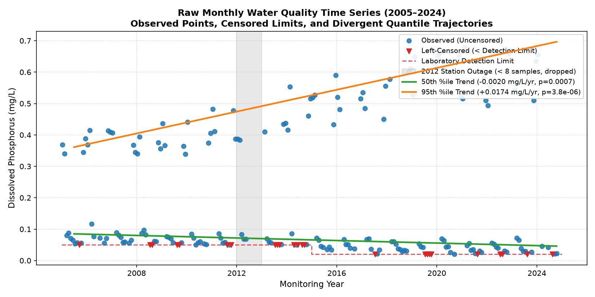
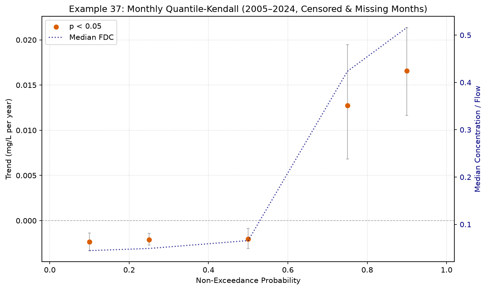

# Example 37: Monthly Sampled Data with Missing Values & Censoring

## Overview & Real-World Practicality

Environmental, hydrological, and water quality monitoring programs are very commonly conducted on a **monthly sampling schedule** (12 planned observations per year). Long-term monitoring records typically span **10 to 25 years** ($N \approx 120$ to $300$ observations).

In practical applications, these datasets present three major analytical challenges:
1. **Low Within-Block Sample Size ($N \approx 12$)**: Each year contains at most 12 samples, meaning high-density order statistics (e.g. 50 or 100 quantiles) cannot be estimated without extreme extrapolation.
2. **Missing Observations**: Bad weather, frozen streams, equipment downtime, or funding gaps frequently cause missed monthly sampling visits (e.g., 9–11 samples collected instead of 12), and occasionally an entire year may lack sufficient data.
3. **Censored Data & Changing Detection Limits**: Trace contaminants (e.g., dissolved phosphorus, nitrate, pesticides, heavy metals) frequently fall below analytical laboratory detection limits ($< 0.05$ mg/L or $< 0.02$ mg/L). As analytical instruments improve over time, the detection limit often drops, creating an artificial downward trend if not handled rigorously.

`MannKS.quantile_trend_test` natively resolves all three challenges.

---

## Dataset Characteristics

In this example, we evaluate a 20-year dissolved phosphorus record (2005–2024) with realistic monitoring imperfections:
- **Planned Sampling**: 20 years $\times$ 12 months = 240 planned visits.
- **Data Completeness**: ~12% randomly missed monthly visits, leaving 202 collected observations.
- **Incomplete Year Exclusion**: Years with fewer than 8 samples (2012 station outage with 5 samples, and 2024 where missed monthly visits left 6 samples) are safely excluded by `min_size_per_block=8`, leaving **18 valid annual blocks** ($N_{\text{blocks}} = 18 \ge 10$).
- **Censored Detection Limits**:
  - 2005–2014: Standard method ($< 0.05$ mg/L).
  - 2015–2024: Upgraded high-sensitivity method ($< 0.02$ mg/L).
  - Total censored observations: **24 (11.9%)**.
- **Underlying Asymmetric Trend**:
  - Baseline concentrations (lower/median quantiles) are **improving (decreasing)** due to wastewater treatment facility upgrades.
  - Peak storm runoff pulses (upper quantiles, 90th–95th percentiles) are **worsening (increasing)** due to expanding impervious surfaces and agricultural runoff flushes.

---

## 1. Visualizing the Original Monitoring Data

Before decomposing the distribution into quantiles, we inspect the full monthly time series. The plot below illustrates the dataset:
- **Observed non-censored concentrations** (solid blue circles)
- **Left-censored values** (red inverted triangles plotted at the detection limit)
- **Laboratory detection limit transitions** (dashed red step line at $0.05$ mg/L from 2005–2014, improving to $0.02$ mg/L from 2015–2024)
- **Station outage** (shaded grey band during 2012 when only 5 samples were collected and subsequently dropped by `min_size_per_block=8`)
- **Divergent trend trajectories**: The **50th percentile (median) trend** is steadily decreasing (green line), while the **95th percentile storm pulse trend** is rapidly increasing (orange line).



---

## 2. The Danger of Classical Median Analysis

Running a classical monotonic trend test (e.g., Mann-Kendall or Seasonal Mann-Kendall on the median) yields:
- **Sen's Slope**: `-0.00157 mg/L/year`
- **p-value**: `1.6945e-02`
- **Classification**: **Highly Likely Decreasing**

> [!WARNING]
> The classical median test reports a statistically significant "Improving / Decreasing" trend. A water resources manager relying solely on the median would conclude the watershed is recovering, completely missing the fact that **extreme peak pollution flushes (90th–95th percentiles) are actively worsening**!

---

## Generalized Quantile-Kendall Workflow

### Step 1: Preprocess Censored Strings
Use `MannKS.prepare_censored_data` to automatically parse numeric and censored strings (e.g., `'<0.05'`, `'0.084'`):
```python
from MannKS import prepare_censored_data, quantile_trend_test, plot_quantile_trend

# Automatically creates DataFrame with 'value', 'censored', and 'cen_type'
censored_df = prepare_censored_data(raw_data_strings)
```

### Step 2: Configure Parameters for Monthly Data
For monthly data ($N \approx 12$ per block), choose parameters tailored to the monthly sampling frequency, including regulatory NPS-FM percentiles:
- `quantiles=[0.10, 0.25, 0.50, 0.75, 0.90, 0.92, 0.95]`: Spans baseflow (10th/25th), median (50th), storm runoff flush (75th/90th), and NPS-FM regulatory thresholds (92nd and 95th).
- `standardization='interpolate'`: Uses robust linear percentile interpolation to estimate quantiles from 8–12 monthly points per block.
- `min_size_per_block=8`: Requires at least 8 samples per year, allowing years with 1–4 missed months to be retained while dropping severely compromised years (e.g., 2012 with only 5 samples).
- `min_blocks=10`: Ensures at least 10 valid annual blocks exist across the 20-year span.
- `censor_quantile_method='propagate'`: Flags order statistics at or below detection limits as censored without distorting uncensored upper quantiles.
- `sens_slope_method='ats'`: Uses Akritas-Theil-Sen slope estimation for quantiles containing censored points.

```python
result = quantile_trend_test(
    x=censored_df,
    t=dates,
    block_frequency='YE',               # Group by calendar year
    quantiles=[0.10, 0.25, 0.50, 0.75, 0.90, 0.92, 0.95],
    standardization='interpolate',       # Linear interpolation
    censor_quantile_method='propagate',  # Rigorous censor tracking
    sens_slope_method='ats',             # Akritas-Theil-Sen
    min_size_per_block=8,               # Tolerate up to 4 missing months
    min_blocks=10,                      # Require >= 10 valid years
    slope_scaling='year',               # Slopes in mg/L/year
    x_unit='mg/L',
)
```

---

## Numerical Results

| Quantile | Sen's Slope (mg/L/yr) | 95% Confidence Interval | p-value | Classification | % Censored | Valid Blocks |
| :---: | :---: | :---: | :---: | :---: | :---: | :---: |
| **0.10** | -0.00236 | [-0.00332, -0.00135] | 1.0550e-02 | Highly Likely Decreasing | 44.4% | 18 |
| **0.25** | -0.00211 | [-0.00268, -0.00142] | 3.9684e-05 | Highly Likely Decreasing | 16.7% | 18 |
| **0.50** | -0.00202 | [-0.00310, -0.00084] | 6.5203e-04 | Highly Likely Decreasing | 0.0% | 18 |
| **0.75** | +0.01275 | [+0.00683, +0.01948] | 8.5842e-04 | Highly Likely Increasing | 0.0% | 18 |
| **0.90** | +0.01659 | [+0.01163, +0.02137] | 7.8377e-06 | Highly Likely Increasing | 0.0% | 18 |
| **0.92** | +0.01698 | [+0.01261, +0.02062] | 2.6422e-06 | Highly Likely Increasing | 0.0% | 18 |
| **0.95** | +0.01739 | [+0.01360, +0.02016] | 3.8175e-06 | Highly Likely Increasing | 0.0% | 18 |

### Key Findings
1. **Low Quantiles ($p = 0.10, 0.25$)**: Exhibit significant downward slopes with non-zero censoring proportions (`prop_censored`). The Akritas-Theil-Sen estimator correctly accounts for changing detection limits without artificial step-trend artifacts.
2. **Median ($p = 0.50$)**: Confirms steady baseline improvement ($p < 0.05$).
3. **Upper Quantiles ($p = 0.75, 0.90, 0.92, 0.95$)**: 100% uncensored (`prop_censored = 0.0%`) and demonstrate strong **positive slopes**. The Quantile-Kendall test successfully reveals the worsening storm pulse flushes that dominate the regulatory extremes.

---

## NPS-FM Context: Calculating 92nd and 95th Percentiles on Monthly Records

In water quality management under the **New Zealand National Policy Statement for Freshwater Management (NPS-FM 2020)**, attribute states and objective framework bands (e.g., *E. coli* primary contact recreation criteria, dissolved reactive phosphorus, toxic ammonia, and cyanobacteria) frequently rely on the **95th percentile** or **92nd percentile**.

When applying Quantile-Kendall to monthly monitoring datasets over **10 to 20 years**:

### 1. Order-Statistic Behavior for $N \approx 12$ Samples/Year
Within an annual block of 12 monthly samples:
- The 12th (highest) sample has non-exceedance probability $p \approx 0.92$ (Weibull $12/13$) or $p \approx 0.96$ (Hazen $(12 - 0.5)/12$).
- The 11th (second-highest) sample has $p \approx 0.85$ to $0.88$.
- **The 92nd percentile** is interpolated between the 11th and 12th samples ($1 + 0.92 \times 11 = 11.12$ in 1-based rank: $0.88\,x_{(11)} + 0.12\,x_{(12)}$), primarily tracking the **second-highest monthly value** of the year.
- **The 95th percentile** uses Type-7 linear interpolation ($1 + 0.95 \times 11 = 11.45$ in 1-based rank, or index $10.45$ in 0-based indexing: $0.55\,x_{(11)} + 0.45\,x_{(12)}$), blending nearly equally between the second-highest and highest monthly values.

In hydrological terms, evaluating trends in the 92nd and 95th percentiles tests whether the **annual peak runoff events are intensifying** over time.

### 2. Time Horizon Considerations (10 Years vs. 20 Years)
- **20 Years ($N_{\text{blocks}} = 20$):** Very reliable. The 20 annual estimates provide sufficient degrees of freedom for the Mann-Kendall test ($S_{\max} = 190$) to filter out natural year-to-year storm variability and identify true monotonic trends in extreme flushes.
- **10 Years ($N_{\text{blocks}} = 10$):** Feasible, but confidence intervals around the Sen's slope will naturally be wider. An isolated extreme storm year exerts higher leverage when only 10 blocks are present.

### 3. Multi-Year Pooling Option (`block_frequency='2YE'`)
If within-block percentile stabilization is desired, consecutive years can be pooled into 2-year blocks (`block_frequency='2YE'`, $N \approx 24$ samples per block), giving more empirical points above the 95th percentile.

---

## Visual Diagnostic Plot

```python
plot_quantile_trend(
    result,
    save_path='monthly_censored_qk.png',
    show_ci=True,
    show_fdc=True,
    x_scale='linear',
    title='Monthly Water Quality (2005–2024, Censored & Missing Months)',
)
```



---

## Best Practices for Monthly Datasets (10–25 Years)

| Scenario / Decision | Recommendation | Rationale |
| :--- | :--- | :--- |
| **Quantile Selection** | Include median, quartiles, and regulatory percentiles: `[0.10, 0.25, 0.50, 0.75, 0.90, 0.92, 0.95]` | Provides full distributional coverage while capturing critical NPS-FM regulatory thresholds. |
| **Interpolation Method** | `standardization='interpolate'` (default) | Handles varying block sizes ($N=8$ to $12$) smoothly via linear percentile interpolation. |
| **Missing Month Tolerance** | `min_size_per_block=8` (or 9) | Prevents losing entire years just because 1 or 2 monthly visits were missed. |
| **Missing Year Spacing** | Supported natively | Mann-Kendall evaluates pairwise time differences $\Delta t = t_j - t_i$; missing years do not bias test statistics. |
| **Censored Data** | `censor_quantile_method='propagate'` | Ensures lower percentiles retain `< DL` flags while upper percentiles remain completely uncensored. |
| **Quantile vs Seasonal MK** | Choose based on hypothesis | Use **Seasonal MK** to ask *"Is January getting wetter?"*; use **Quantile-Kendall** to ask *"Are annual drought baseflows or peak storm flushes intensifying?"* regardless of timing. |
