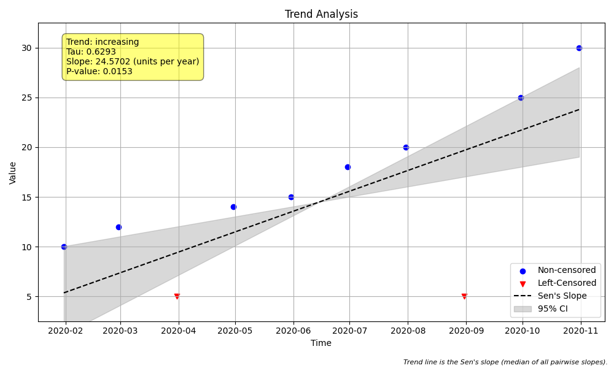

<div align="center">
  

  # MannKS
  ### (Mann-Kendall Sen)

  **Robust Trend Analysis in Python**
</div>

---

## 📦 Installation

```bash
pip install mannks
```

**Requirements:** Python 3.9+, NumPy, Pandas (≥ 2.2), SciPy, Matplotlib, Seaborn, Piecewise-Regression

---

## ✨ What is MannKS?

**MannKS** (Mann-Kendall Sen) is a Python package for detecting trends in time series data using non-parametric methods. It's specifically designed for environmental monitoring, water quality analysis, and other fields where data is messy, irregular, or contains detection limits.

### When to Use MannKS

Use this package when your data has:
- **Irregular sampling intervals** (daily → monthly → quarterly)
- **Censored values** (measurements like `<5` or `>100`)
- **Seasonal patterns** you need to account for
- **No normal distribution** (non-parametric methods don't require it)
- **Small to large sample sizes** (Automatic support for n > 10,000)

---

## 🆕 What's New

> **Upgrading from 0.5.x?** Version 0.6 is a correctness release. Several statistical defects were fixed and some defaults changed, so **results can differ from earlier versions**. Re-run analyses before comparing old and new results. The [changelog](https://github.com/LukeAFullard/MannKS/blob/main/CHANGELOG.md) lists every change.

| Version | Highlights | Learn more |
| :--- | :--- | :--- |
| **0.7.1** | **Corrected dependency minimums.** Packaging-only release: requires `scipy >= 1.10`, `matplotlib >= 3.6.0` and `seaborn >= 0.13.0`, the lowest versions on which the full test suite passes. No library code or numerical results changed from 0.7.0. | [Changelog](https://github.com/LukeAFullard/MannKS/blob/main/CHANGELOG.md) |
| **0.7.0** | **Generalized Quantile-Kendall trend analysis.** Frequency-agnostic order-statistic trend tests generalizing USGS EGRET to arbitrary frequencies (daily, weekly, monthly, multi-year blocks), censored data with ATS slope estimation, coverage filtering, sampling frequency drift protection (`equalize='thin'`/`'aggregate'`), permutation field significance, and dual normal Z / probability plotting (`plot_quantile_trend`). | [Changelog](https://github.com/LukeAFullard/MannKS/blob/main/CHANGELOG.md) · [Methodology](https://github.com/LukeAFullard/MannKS/blob/main/quantile_kendall.md) · [Quantile Guide](https://github.com/LukeAFullard/MannKS/blob/main/Examples/Detailed_Guides/quantile_trend_guide.md) · [Example 36](https://github.com/LukeAFullard/MannKS/tree/main/Examples/36_Quantile_Kendall) · [Example 37](https://github.com/LukeAFullard/MannKS/tree/main/Examples/37_Monthly_Censored_Quantile_Kendall) · [Validation](https://github.com/LukeAFullard/MannKS/tree/main/validation/43_Quantile_Kendall) |
| **0.6.3** | **Scientific audit & correctness release.** Corrects direct confidence interval indexing per Gilbert (1987) Eq. 16.8, implements full interval ordering for robust right-censored Mann-Kendall, fixes plotting figure memory leaks, optimizes rolling trend search and pair-sampling memory, and aligns seasonal test result fields while preserving 100% LWP-TRENDS parity. | [Changelog](https://github.com/LukeAFullard/MannKS/blob/main/CHANGELOG.md) |
| **0.6.2** | **32-bit / Pyodide compatibility.** Fixes `int64` → `int32` safe-casting error in `_iter_triu_blocks` and standardizes internal indexing arrays on pointer-sized `np.intp` across all estimators. | [Changelog](https://github.com/LukeAFullard/MannKS/blob/main/CHANGELOG.md) |
| **0.6.1** | **Large data sets, robustly.** Censored data now scale like uncensored data (1,000,000 values in about a second); exact mode is 4–9× faster with a third to two-thirds of the memory; seasonal tests use every observation; a reliable fast-mode error estimate; fixes for missing dates and for bootstrap intervals on large data. | [Changelog](https://github.com/LukeAFullard/MannKS/blob/main/CHANGELOG.md) · [Large Dataset Guide](https://github.com/LukeAFullard/MannKS/blob/main/Examples/Detailed_Guides/large_dataset_guide.md) |
| **0.6.0** | **Correctness release**, audited against the LWP-TRENDS R code and NADA. Var(S) includes the tie and censoring corrections; censored slopes default to the Akritas–Theil–Sen estimator; results no longer depend on row order; exact `'full'` mode. | [Changelog](https://github.com/LukeAFullard/MannKS/blob/main/CHANGELOG.md) · [R parity suite](https://github.com/LukeAFullard/MannKS/tree/main/validation/r_parity) |
| 0.5.0 | **Large data sets**: fast mode estimates the slope from a sample of pairs. | [Example 35](https://github.com/LukeAFullard/MannKS/tree/main/Examples/35_Large_Data_Trend) · [Large Dataset Guide](https://github.com/LukeAFullard/MannKS/blob/main/Examples/Detailed_Guides/large_dataset_guide.md) |
| 0.4.0 | **Segmented trends**: `segmented_trend_test` finds breakpoints, then estimates a robust slope for each segment. | [Example 32](https://github.com/LukeAFullard/MannKS/tree/main/Examples/32_Segmented_Regression) · [Segmented Guide](https://github.com/LukeAFullard/MannKS/blob/main/Examples/Detailed_Guides/segmented_trend_guide.md) |
| 0.3.0 | **Rolling trends**: `rolling_trend_test` over moving windows, and `compare_periods` to test before vs. after an intervention. | [Example 31](https://github.com/LukeAFullard/MannKS/tree/main/Examples/31_Rolling_Trend_Analysis) · [Rolling Guide](https://github.com/LukeAFullard/MannKS/blob/main/Examples/Detailed_Guides/rolling_trend_guide.md) |
| 0.2.0 | **Block bootstrap** for autocorrelated data (`autocorr_method='block_bootstrap'`). | [Example 29](https://github.com/LukeAFullard/MannKS/tree/main/Examples/29_Block_Bootstrap_Autocorrelation) · [Methodology](https://github.com/LukeAFullard/MannKS/blob/main/bootstrap.md) |

---

## 🚀 Quick Start

```python
import pandas as pd
from MannKS import prepare_censored_data, trend_test

# 1. Prepare data with censored values
# Converts strings like '<5' into a structured format
values = [10, 12, '<5', 14, 15, 18, 20, '<5', 25, 30]
dates = pd.date_range(start='2020-01-01', periods=len(values), freq='ME')
data = prepare_censored_data(values)

# 2. Run trend test
# slope_scaling converts slope from "per second" to "per year"
result = trend_test(
    x=data,
    t=dates,
    slope_scaling='year',
    x_unit='mg/L',
    plot_path='trend.png'
)

# 3. Interpret results
print(f"Trend: {result.classification}")
print(f"Slope: {result.slope:.2f} {result.slope_units}")
print(f"Confidence: {result.C:.2%}")
```

**Output:**
```
Trend: Highly Likely Increasing
Slope: 24.57 mg/L per year
Confidence: 99.23%
```



---

## 🎯 Key Features

### Core Functionality
- **Mann-Kendall Trend Test**: Detect monotonic trends with statistical significance
- **Sen's Slope Estimator**: Calculate trend magnitude with confidence intervals
- **Seasonal Analysis**: Separate seasonal signals from long-term trends
- **Regional Aggregation**: Combine results across multiple monitoring sites

### Data Handling
- **Censored Data Support**: Native handling of detection limits (`<5`, `>100`)
  - Slope estimators: Akritas-Theil-Sen (default), LWP-TRENDS-compatible, and drop-ambiguous-pairs
  - Handles left-censored, right-censored, and mixed censoring
- **Unequal Spacing**: Uses actual time differences (not just rank order)
- **Missing Data**: Automatically handles NaN values and missing seasons
- **Temporal Aggregation**: Multiple strategies for high-frequency data
- **Large Data Sets**: Exact test and fast slope estimation, tested up to 1,000,000 observations

### Statistical Features
- **Continuous Confidence**: Reports likelihood ("Highly Likely Increasing") not just p-values
- **Data Quality Checks**: Automatic warnings for tied values, long runs, insufficient data
- **Robust Methods**: Akritas-Theil-Sen estimator for censored data (default)
- **Flexible Testing**: Kendall's Tau-a or Tau-b, custom significance levels
- **Rolling Trends**: Analyze how trends evolve over time with `rolling_trend_test`. See [Example 31](https://github.com/LukeAFullard/MannKS/tree/main/Examples/31_Rolling_Trend_Analysis).
- **Segmented Trends**: Automatically detect breakpoints and analyze trends in segments with `segmented_trend_test`. See [Example 32](https://github.com/LukeAFullard/MannKS/tree/main/Examples/32_Segmented_Regression).
- **Block Bootstrap**: Robust trend testing for autocorrelated data with automatic ACF-based block size selection. See [bootstrap.md](https://github.com/LukeAFullard/MannKS/blob/main/bootstrap.md) for details and [Example 29](https://github.com/LukeAFullard/MannKS/tree/main/Examples/29_Block_Bootstrap_Autocorrelation).
- **Generalized Quantile-Kendall Trends**: Evaluate divergent trends across all quantiles (e.g. increasing flood peaks vs declining drought baseflows) with `quantile_trend_test` and `plot_quantile_trend`. See [quantile_kendall.md](https://github.com/LukeAFullard/MannKS/blob/main/quantile_kendall.md) for methodology, the [Quantile Trend Guide](https://github.com/LukeAFullard/MannKS/blob/main/Examples/Detailed_Guides/quantile_trend_guide.md), and [Example 36](https://github.com/LukeAFullard/MannKS/tree/main/Examples/36_Quantile_Kendall).


---

## 📊 Example Use Cases

### Seasonal Water Quality Trend
```python
from MannKS import seasonal_trend_test, check_seasonality

# Check if seasonality exists (period=12 is inferred from season_type='month')
seasonality = check_seasonality(x=data, t=dates, season_type='month')
print(f"Seasonal pattern detected: {seasonality.is_seasonal}")

# Run seasonal trend test
result = seasonal_trend_test(
    x=data,
    t=dates,
    season_type='month',         # Infers period=12 automatically
    agg_method='robust_median',  # Aggregates multiple samples per month
    slope_scaling='year'
)
```

### Regional Analysis Across Sites
```python
from MannKS import regional_test

# Run trend tests for each site
site_results = []
for site in ['Site_A', 'Site_B', 'Site_C']:
    result = trend_test(x=site_data[site], t=dates)
    site_results.append({
        'site': site,
        's': result.s,
        'C': result.C
    })

# Aggregate regional trend
regional = regional_test(
    trend_results=pd.DataFrame(site_results),
    time_series_data=all_site_data,
    site_col='site'
)
print(f"Regional trend: {regional.DT}, confidence: {regional.CT:.2%}")
```

---

## 📈 Large Data Sets

```python
result = trend_test(x_large, t_large)          # automatic: exact up to n = 5,000, fast above
result = trend_test(x, t, large_dataset_mode='fast', max_pairs=500_000)   # more pairs, more accuracy
print(result.computation_mode, result.approximation_error)
```

The Mann-Kendall test (S, Var(S), p) is **exact in every mode**, including for censored data and seasonal tests. Above 5,000 observations, only the slope and its confidence interval are estimated from a random sample of pairs (reproducible by default). `approximation_error` gives the 95% half-width of that sampling error.

Single core, default settings:

| Observations | Mode | Uncensored | 30% censored | Peak memory |
| ---: | :--- | ---: | ---: | ---: |
| 5,000 | Full (exact) | 1.2 s | 1.5 s | < 1 GB |
| 50,000 | Fast | 0.1 s | 0.2 s | 0.2 GB |
| 1,000,000 | Fast (with a warning recommending aggregation) | 1.0 s | 1.2 s | 0.5 GB |

In simulations, fast-mode confidence intervals contained the true slope 95–96% of the time.

- **Exact slopes** (`large_dataset_mode='full'`) need memory for all n(n-1)/2 pairs. They are practical up to about n = 20,000, and above n = 46,340 MannKS uses fast mode instead.
- **High-frequency data**: aggregating first with `agg_method`/`agg_period` (e.g. daily or monthly medians) is usually better than analysing every value.
- **Slower options at large n**: the block bootstrap (about 0.05 s per resample at n = 50,000) and the breakpoint search of `segmented_trend_test` (over a minute at n = 30,000).

See the [Large Dataset Guide](https://github.com/LukeAFullard/MannKS/blob/main/Examples/Detailed_Guides/large_dataset_guide.md) for details and accuracy measurements.

---

## ⚠️ Important Limitations

### Statistical Assumptions
- **Independence**: Data points must be serially independent
  - Autocorrelation violates this and causes spurious significance
  - Pre-test with ACF or use block bootstrap methods if autocorrelated
- **Monotonic trend**: Cannot detect U-shaped or cyclical patterns
- **Homogeneous variance**: Most powerful when variance is constant over time

---

## 📚 Documentation

### Detailed Guides
- **[Trend Test Parameters](https://github.com/LukeAFullard/MannKS/blob/main/Examples/Detailed_Guides/trend_test_parameters_guide.md)** - Full parameter reference
- **[Seasonal Analysis](https://github.com/LukeAFullard/MannKS/blob/main/Examples/Detailed_Guides/seasonal_trend_test_parameters_guide.md)** - Season types and aggregation
- **[Regional Tests](https://github.com/LukeAFullard/MannKS/blob/main/Examples/Detailed_Guides/regional_test_guide/README.md)** - Multi-site aggregation
- **[Analysis Notes](https://github.com/LukeAFullard/MannKS/blob/main/Examples/Detailed_Guides/analysis_notes_guide.md)** - Interpreting data quality warnings
- **[Trend Classification](https://github.com/LukeAFullard/MannKS/blob/main/Examples/Detailed_Guides/trend_classification_guide.md)** - Understanding confidence levels
- **[Bootstrap Methodology](https://github.com/LukeAFullard/MannKS/blob/main/bootstrap.md)** - Block bootstrap for autocorrelated data
- **[Rolling Trend Analysis](https://github.com/LukeAFullard/MannKS/blob/main/Examples/Detailed_Guides/rolling_trend_guide.md)** - Moving window analysis
- **[Segmented Trend Analysis](https://github.com/LukeAFullard/MannKS/blob/main/Examples/Detailed_Guides/segmented_trend_guide.md)** - Structural breakpoint detection
- **[Large Dataset Analysis](https://github.com/LukeAFullard/MannKS/blob/main/Examples/Detailed_Guides/large_dataset_guide.md)** - Fast mode, accuracy and performance
- **[Quantile-Kendall Methodology](https://github.com/LukeAFullard/MannKS/blob/main/quantile_kendall.md)** - What, why, how, and full options for Quantile-Kendall analysis
- **[Quantile Trend Analysis](https://github.com/LukeAFullard/MannKS/blob/main/Examples/Detailed_Guides/quantile_trend_guide.md)** - Practical recipes, parameter reference, and pitfalls

### Examples
The [Examples](https://github.com/LukeAFullard/MannKS/blob/main/Examples/README.md) folder contains step-by-step tutorials from basic to advanced usage.

---

## 🔬 Validation

Validated against:
- **LWP-TRENDS R script (v2502)**, run live via `Rscript`. With the LWP settings (`alpha=0.1`, `mk_test_method='lwp'`, `ci_method='lwp'`, `sens_slope_method='lwp'`, `tau_method='a'`, `tie_break_method='lwp'`, `agg_method='lwp'`), S, Var(S), Z, p, C, Cd, tau, the Sen slope and its confidence interval, and `sen_probability` agree to 1e-6 (relative). This holds on synthetic edge cases and on the LWP example data sets. The documented exceptions are cases where LWP-TRENDS declines to compute, and fast-mode sampling. Frozen R reference values are tested in `tests/test_lwp_parity.py`.
- **NADA::cenken** (Akritas-Theil-Sen): agreement within NADA's own bisection tolerance (median 0.3%).
- **Exact permutation distributions and Monte Carlo** (Type-I error, CI coverage, slope bias).

See [validation/r_parity](https://github.com/LukeAFullard/MannKS/tree/main/validation/r_parity) for the scripts, and [validation/](https://github.com/LukeAFullard/MannKS/tree/main/validation) for the scenario studies.

---

## 🙏 Acknowledgments

This package is heavily inspired by the excellent work of **[LandWaterPeople (LWP)](https://landwaterpeople.co.nz/)**. The robust censored data handling and regional aggregation methods are based on their R scripts and methodologies.

---

## 📖 References

1.  **Helsel, D.R. (2012).** *Statistics for Censored Environmental Data Using Minitab and R* (2nd ed.). Wiley.
2.  **Gilbert, R.O. (1987).** *Statistical Methods for Environmental Pollution Monitoring*. Wiley.
3.  **Hirsch, R.M., Slack, J.R., & Smith, R.A. (1982).** Techniques of trend analysis for monthly water quality data. *Water Resources Research*, 18(1), 107-121.
4.  **Mann, H.B. (1945).** Nonparametric tests against trend. *Econometrica*, 13(3), 245-259.
5.  **Sen, P.K. (1968).** Estimates of the regression coefficient based on a particular kind of rank correlation. *Journal of the American Statistical Association*, 63(324), 1379-1389.
6.  **Fraser, C., & Whitehead, A. L. (2022).** Continuous measures of confidence in direction of environmental trends at site and other spatial scales. *Environmental Challenges*, 9, 100601.
7.  **Fraser, C., Snelder, T., & Matthews, A. (2018).** State and trends of river water quality in the Manawatu-Whanganui region. Report for Horizons Regional Council.
8.  **Hirsch, R.M., Archfield, S.A., & De Cicco, L.A. (2015).** A bootstrap method for estimating uncertainty of water quality trends. *Environmental Modelling & Software*, 73, 148-166.
9.  **Hirsch, R.M., & De Cicco, L.A. (2015).** User guide to Exploration and Graphics for RivEr Trends (EGRET) and dataRetrieval: R packages for surface-water quality and streamflow. *USGS Techniques and Methods Book 4, Section A10*.
