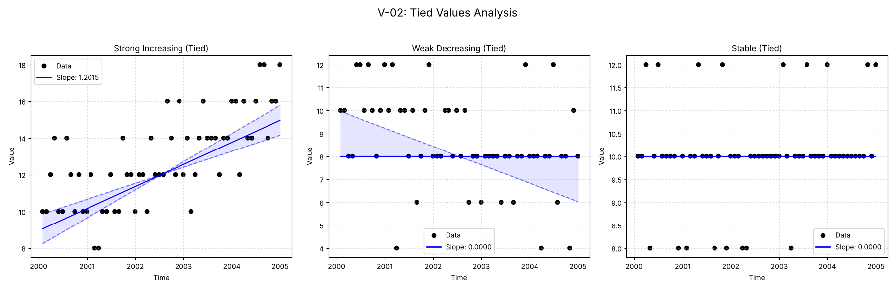
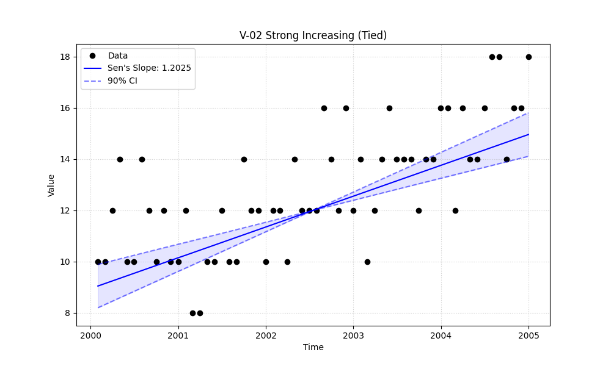

# Validation Report

## Plots
### v02_combined.png

### v02_strong.png

## Results
| Test ID                     | Method            |       Slope |     P-Value |   Lower CI |   Upper CI |
|:----------------------------|:------------------|------------:|------------:|-----------:|-----------:|
| V-02_strong_increasing_tied | MannKS (Standard) | 1.20148     | 1.97418e-09 |   0.872239 |    1.53252 |
| V-02_strong_increasing_tied | MannKS (LWP Mode) | 1.20148     | 1.97418e-09 |   0.94076  |    1.49693 |
| V-02_strong_increasing_tied | LWP-TRENDS (R)    | 1.20148     | 1.97418e-09 |   0.94076  |    1.49693 |
| V-02_strong_increasing_tied | MannKS (ATS)      | 1.20148     | 1.97418e-09 |   0.872239 |    1.53252 |
| V-02_strong_increasing_tied | NADA2 (R)         | 1.20247     | 1.97418e-09 | nan        |  nan       |
| V-02_weak_decreasing_tied   | MannKS (Standard) | 0           | 0.000458025 |  -0.799234 |    0       |
| V-02_weak_decreasing_tied   | MannKS (LWP Mode) | 0           | 0.000458025 |  -0.72759  |    0       |
| V-02_weak_decreasing_tied   | LWP-TRENDS (R)    | 0           | 0.000458025 |  -0.72759  |    0       |
| V-02_weak_decreasing_tied   | MannKS (ATS)      | 0           | 0.000458025 |  -0.799234 |    0       |
| V-02_weak_decreasing_tied   | NADA2 (R)         | 3.61818e-08 | 0.000458025 | nan        |  nan       |
| V-02_stable_tied            | MannKS (Standard) | 0           | 0.164306    |   0        |    0       |
| V-02_stable_tied            | MannKS (LWP Mode) | 0           | 0.164306    |   0        |    0       |
| V-02_stable_tied            | LWP-TRENDS (R)    | 0           | 0.164306    |   0        |    0       |
| V-02_stable_tied            | MannKS (ATS)      | 0           | 0.164306    |   0        |    0       |
| V-02_stable_tied            | NADA2 (R)         | 2.75103e-08 | 0.164306    | nan        |  nan       |

## LWP Accuracy (Python vs R)
| Test ID                     |   Slope Error |   Slope % Error |
|:----------------------------|--------------:|----------------:|
| V-02_strong_increasing_tied |             0 |               0 |
| V-02_weak_decreasing_tied   |             0 |              -0 |
| V-02_stable_tied            |             0 |               0 |
