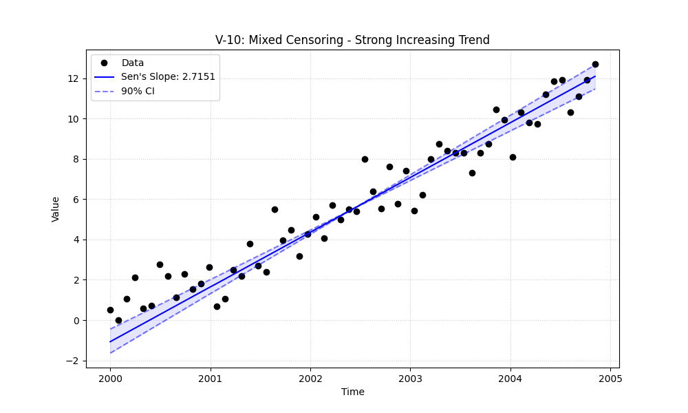
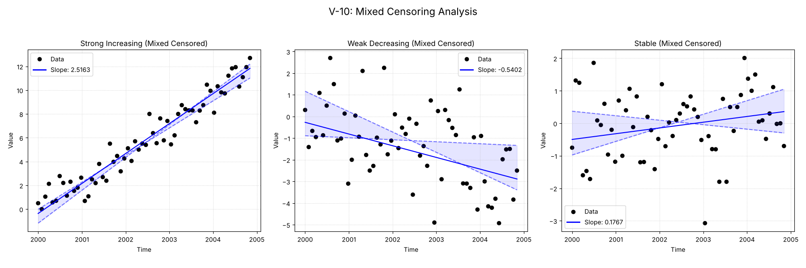

# Validation Report

## Plots
### V-10_strong_increasing_plot.png

### v10_combined.png

## Results
| Test ID                | Method            |     Slope |     P-Value |   Lower CI |    Upper CI |
|:-----------------------|:------------------|----------:|------------:|-----------:|------------:|
| V-10_Strong_Increasing | MannKS (Standard) |  2.51629  | 2.82071e-12 |   2.2762   |   2.75926   |
| V-10_Strong_Increasing | MannKS (LWP Mode) |  2.41776  | 2.06917e-10 |   2.14649  |   2.65108   |
| V-10_Strong_Increasing | LWP-TRENDS (R)    |  2.41776  | 2.06917e-10 |   2.14649  |   2.65108   |
| V-10_Strong_Increasing | MannKS (ATS)      |  2.51629  | 2.82071e-12 |   2.2762   |   2.75926   |
| V-10_Strong_Increasing | NADA2 (R)         |  2.51903  | 2.82063e-12 | nan        | nan         |
| V-10_Weak_Decreasing   | MannKS (Standard) | -0.540167 | 0.0033235   |  -0.939984 |  -0.0921585 |
| V-10_Weak_Decreasing   | MannKS (LWP Mode) |  0        | 0.0433299   |  -0.130958 |   0         |
| V-10_Weak_Decreasing   | LWP-TRENDS (R)    |  0        | 0.0433299   |  -0.130958 |   0         |
| V-10_Weak_Decreasing   | MannKS (ATS)      | -0.540167 | 0.0033235   |  -0.939984 |  -0.0921585 |
| V-10_Weak_Decreasing   | NADA2 (R)         | -0.67191  | 0.0033235   | nan        | nan         |
| V-10_Stable            | MannKS (Standard) |  0.17667  | 0.462634    |  -0.137893 |   0.417796  |
| V-10_Stable            | MannKS (LWP Mode) |  0        | 0.0711884   |   0        |   0.0175253 |
| V-10_Stable            | LWP-TRENDS (R)    |  0        | 0.0711884   |   0        |   0.0175253 |
| V-10_Stable            | MannKS (ATS)      |  0.17667  | 0.462634    |  -0.137893 |   0.417796  |
| V-10_Stable            | NADA2 (R)         |  0.119355 | 0.462634    | nan        | nan         |

## LWP Accuracy (Python vs R)
| Test ID                |   Slope Error |   Slope % Error |
|:-----------------------|--------------:|----------------:|
| V-10_Strong_Increasing |             0 |               0 |
| V-10_Weak_Decreasing   |             0 |              -0 |
| V-10_Stable            |             0 |               0 |
