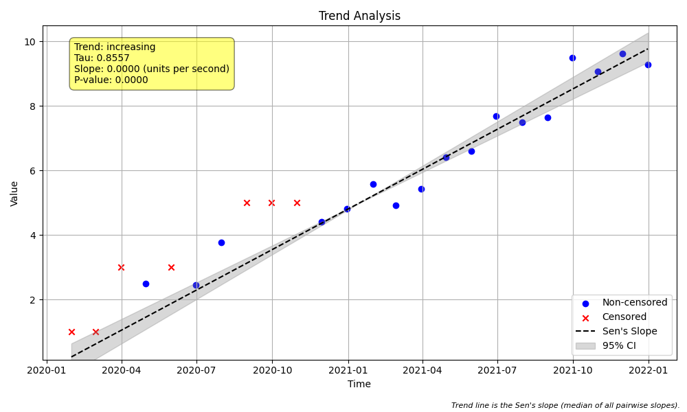
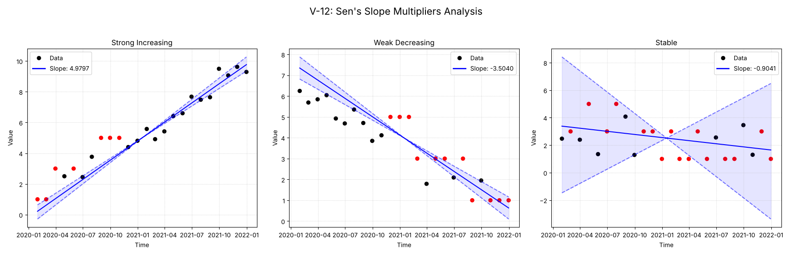

# Validation Report

    # V-12: Sen's Slope Censored Multipliers

    ## Objective
    Isolate and verify the effect of the `lt_mult` and `gt_mult` parameters.
    The test uses data with **multiple censoring levels** (<1, <3, <5) to ensure
    robust validation of multiplier application across different limits.
    

## Plots
### plot_trend.png

### v12_combined.png

## Results
| Test ID                | Method            |      Slope |       P-Value |   Lower CI |   Upper CI |
|:-----------------------|:------------------|-----------:|--------------:|-----------:|-----------:|
| V-12_strong_increasing | MannKS (Standard) |   4.97974  |   5.54381e-08 |    4.54482 |    5.50368 |
| V-12_strong_increasing | MannKS (LWP Mode) |   4.73011  |   5.54381e-08 |    4.36193 |    5.11694 |
| V-12_strong_increasing | LWP-TRENDS (R)    | nan        | nan           |  nan       |  nan       |
| V-12_strong_increasing | MannKS (ATS)      |   4.79649  |   5.54381e-08 |    4.19724 |    6.12154 |
| V-12_strong_increasing | NADA2 (R)         | nan        | nan           |  nan       |  nan       |
| V-12_weak_decreasing   | MannKS (Standard) |  -3.50399  |   2.61466e-05 |   -4.05878 |   -2.95232 |
| V-12_weak_decreasing   | MannKS (LWP Mode) |  -2.89828  |   2.61466e-05 |   -3.31932 |   -1.48264 |
| V-12_weak_decreasing   | LWP-TRENDS (R)    | nan        | nan           |  nan       |  nan       |
| V-12_weak_decreasing   | MannKS (ATS)      |  -3.15586  |   2.61466e-05 |   -6.43325 |   -2.57685 |
| V-12_weak_decreasing   | NADA2 (R)         | nan        | nan           |  nan       |  nan       |
| V-12_stable            | MannKS (Standard) |  -0.904107 |   0.534439    |   -6.15196 |    4.15094 |
| V-12_stable            | MannKS (LWP Mode) |   0        |   0.534439    |    0       |    0       |
| V-12_stable            | LWP-TRENDS (R)    | nan        | nan           |  nan       |  nan       |
| V-12_stable            | MannKS (ATS)      |  -0.669911 |   0.534439    |  -18.3451  |    2.75052 |
| V-12_stable            | NADA2 (R)         | nan        | nan           |  nan       |  nan       |

## LWP Accuracy (Python vs R)
| Test ID                |   Slope Error |   Slope % Error |
|:-----------------------|--------------:|----------------:|
| V-12_strong_increasing |           nan |             nan |
| V-12_weak_decreasing   |           nan |             nan |
| V-12_stable            |           nan |             nan |
