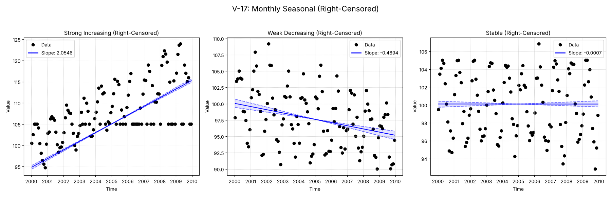

# Validation Report

**V-17: Monthly Seasonal with Right-Censoring**

This test verifies the seasonal trend analysis functionality on a monthly dataset containing right-censored values (e.g., '>100').
It compares the standard `MannKS` seasonal test against the LWP-TRENDS R script and NADA2.

## Plots
### V17_Right_Censored_Seasonal_Analysis.png

## Results
| Test ID                | Method            |        Slope |     P-Value |    Lower CI |    Upper CI |
|:-----------------------|:------------------|-------------:|------------:|------------:|------------:|
| V-17_strong_increasing | MannKS (Standard) |  2.05461     | 2.54135e-14 |   1.97248   |   2.1444    |
| V-17_strong_increasing | MannKS (LWP Mode) |  1.85398     | 1.01389e-19 |   1.71163   |   1.95735   |
| V-17_strong_increasing | LWP-TRENDS (R)    |  1.85398     | 1.01389e-19 |   1.71163   |   1.95735   |
| V-17_strong_increasing | MannKS (ATS)      |  2.05461     | 2.54135e-14 |   1.97248   |   2.1444    |
| V-17_strong_increasing | NADA2 (R)         |  1.612       | 0.002       | nan         | nan         |
| V-17_weak_decreasing   | MannKS (Standard) | -0.489428    | 7.06221e-10 |  -0.623403  |  -0.366033  |
| V-17_weak_decreasing   | MannKS (LWP Mode) | -0.489449    | 6.47102e-11 |  -0.617886  |  -0.381726  |
| V-17_weak_decreasing   | LWP-TRENDS (R)    | -0.489449    | 6.47102e-11 |  -0.617886  |  -0.381726  |
| V-17_weak_decreasing   | MannKS (ATS)      | -0.489428    | 7.06221e-10 |  -0.623403  |  -0.366033  |
| V-17_weak_decreasing   | NADA2 (R)         | -0.5096      | 0.002       | nan         | nan         |
| V-17_stable            | MannKS (Standard) | -0.000744849 | 1           |  -0.0650551 |   0.0720241 |
| V-17_stable            | MannKS (LWP Mode) |  0           | 0.979341    |  -0.0544449 |   0.0554198 |
| V-17_stable            | LWP-TRENDS (R)    |  0           | 0.979341    |  -0.0544449 |   0.0554198 |
| V-17_stable            | MannKS (ATS)      | -0.000744849 | 1           |  -0.0650551 |   0.0720241 |
| V-17_stable            | NADA2 (R)         | -0.06716     | 1           | nan         | nan         |

## LWP Accuracy (Python vs R)
| Test ID                |   Slope Error |   Slope % Error |
|:-----------------------|--------------:|----------------:|
| V-17_strong_increasing |             0 |               0 |
| V-17_weak_decreasing   |             0 |              -0 |
| V-17_stable            |             0 |               0 |
