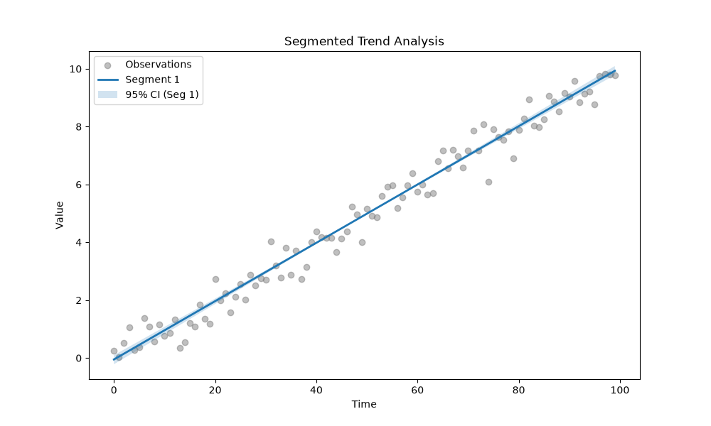
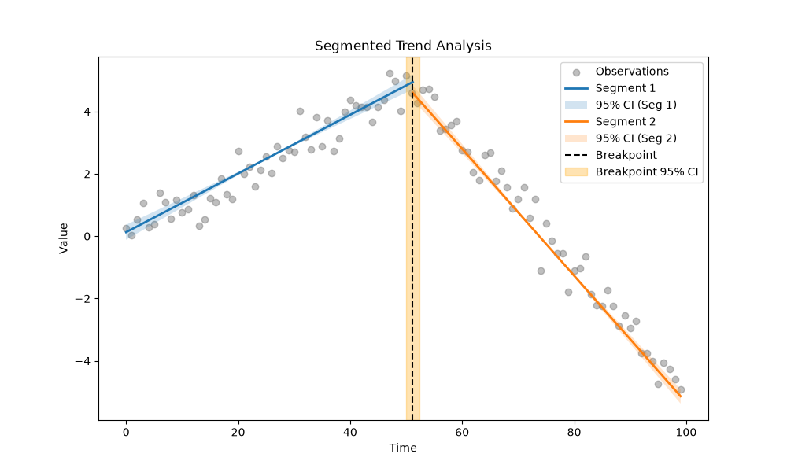
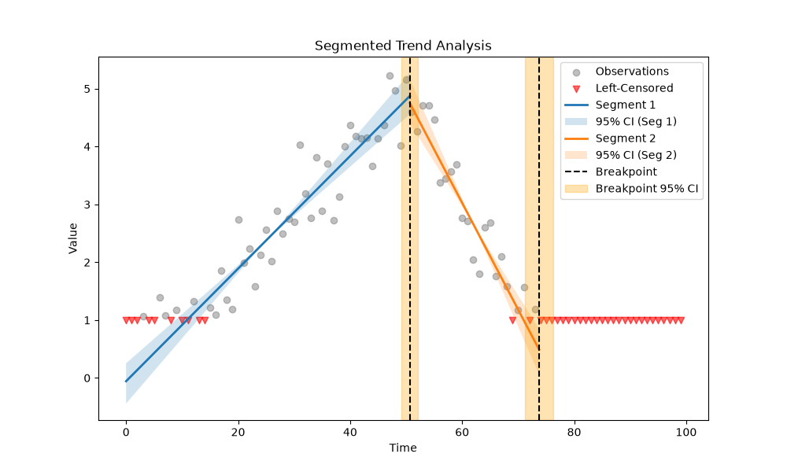
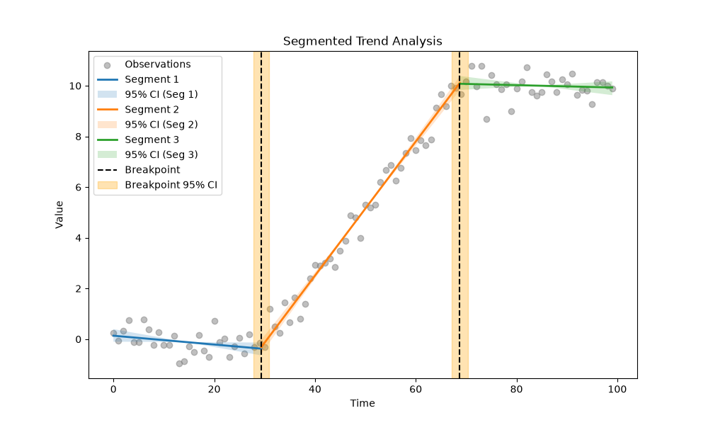

# Validation Report: Segmented Regression

| ID | Description | Success | Result |
|---|---|---|---|
| V-45-01 | No Breakpoint (Linear Trend) | PASS | 0 |
| V-45-02 | Single Hinge Detection (True BP=50) | PASS | 1 |
| V-45-03 | Censored Hinge (Robustness, True BP=50) | FAIL | 2 |
| V-45-04 | Double Jump (True BPs=30, 70) | PASS | 2 |
| V-45-05 | Probability Calibration (True BP=50, Window=[45, 55]) | PASS | Probability: 100.00% |

## Detailed Results

### V-45-01: No Breakpoint (Linear Trend)
**Success:** True

#### Model Selection Summary
|   n_breakpoints |      bic |      aic |     mbic |    score |     rss |     sar | converged   |
|----------------:|---------:|---------:|---------:|---------:|--------:|--------:|:------------|
|               0 | -149.888 | -155.098 | -149.888 | -149.888 | 20.3726 | 20.3726 | True        |
|               1 | -147.084 | -157.505 | -142.479 | -147.084 | 19.1083 | 19.1083 | True        |
|               2 | -140.359 | -155.99  | -131.149 | -140.359 | 18.6392 | 18.6392 | True        |

### V-45-02: Single Hinge Detection (True BP=50)
**Success:** True

#### Model Selection Summary
|   n_breakpoints |      bic |      aic |     mbic |    score |      rss |      sar | converged   |
|----------------:|---------:|---------:|---------:|---------:|---------:|---------:|:------------|
|               0 |  166.271 |  161.061 |  166.271 |  166.271 | 480.959  | 480.959  | True        |
|               1 | -143.925 | -154.345 | -139.319 | -143.925 |  19.7217 |  19.7217 | True        |
|               2 | -140.144 | -155.775 | -130.934 | -140.144 |  18.6794 |  18.6794 | True        |

**Detected Breakpoint:** 51.181343614361644

#### Warnings
- Per-segment slope confidence intervals are conditional on the estimated breakpoints (post-selection inference) and do not account for breakpoint-location uncertainty. Nominal coverage may be lower under low SNR, small slope changes, edge breakpoints, outliers, or serial correlation.

### V-45-03: Censored Hinge (Robustness, True BP=50)
**Success:** False

#### Model Selection Summary
|   n_breakpoints |       bic |       aic |      mbic |     score |      rss |      sar | converged   |
|----------------:|----------:|----------:|----------:|----------:|---------:|---------:|:------------|
|               0 |   85.8194 |   80.6091 |   85.8194 |   85.8194 | 215.134  | 215.134  | True        |
|               1 |  -75.8772 |  -86.2979 |  -71.272  |  -75.8772 |  38.9466 |  38.9466 | True        |
|               2 | -160.453  | -176.084  | -151.243  | -160.453  |  15.2461 |  15.2461 | True        |

**Detected Breakpoint:** [np.float64(50.641489789008595), np.float64(73.74288463025992)]

#### Warnings
- High proportion of censored data (38.0% > 15%). Phase-1 OLS breakpoint detection uses substituted values (lt_mult=0.5, gt_mult=1.1), which may induce spurious breakpoints or over-splitting.
- Detected a contiguous left-censored floor of 26 observations (>= 15); flat censoring shelves can induce spurious breakpoints in Phase-1 OLS.
- Denominator near zero in Tau calculation
- Variance near zero, Z-score may be unreliable
- Per-segment slope confidence intervals are conditional on the estimated breakpoints (post-selection inference) and do not account for breakpoint-location uncertainty. Nominal coverage may be lower under low SNR, small slope changes, edge breakpoints, outliers, or serial correlation.

### V-45-04: Double Jump (True BPs=30, 70)
**Success:** True

#### Model Selection Summary
|   n_breakpoints |      bic |       aic |      mbic |    score |      rss |      sar | converged   |
|----------------:|---------:|----------:|----------:|---------:|---------:|---------:|:------------|
|               0 |   80.109 |   74.8986 |   80.109  |   80.109 | 203.193  | 203.193  | True        |
|               1 |   59.554 |   49.1333 |   64.1592 |   59.554 | 150.883  | 150.883  | True        |
|               2 | -136.662 | -152.293  | -127.452  | -136.662 |  19.3412 |  19.3412 | True        |
|               3 | -131.358 | -152.2    | -117.543  | -131.358 |  18.6002 |  18.6002 | True        |

#### Warnings
- Per-segment slope confidence intervals are conditional on the estimated breakpoints (post-selection inference) and do not account for breakpoint-location uncertainty. Nominal coverage may be lower under low SNR, small slope changes, edge breakpoints, outliers, or serial correlation.

### V-45-05: Probability Calibration (True BP=50, Window=[45, 55])
**Success:** True

**Metric:** Probability: 100.00%

#### Warnings
- Per-segment slope confidence intervals are conditional on the estimated breakpoints (post-selection inference) and do not account for breakpoint-location uncertainty. Nominal coverage may be lower under low SNR, small slope changes, edge breakpoints, outliers, or serial correlation.

